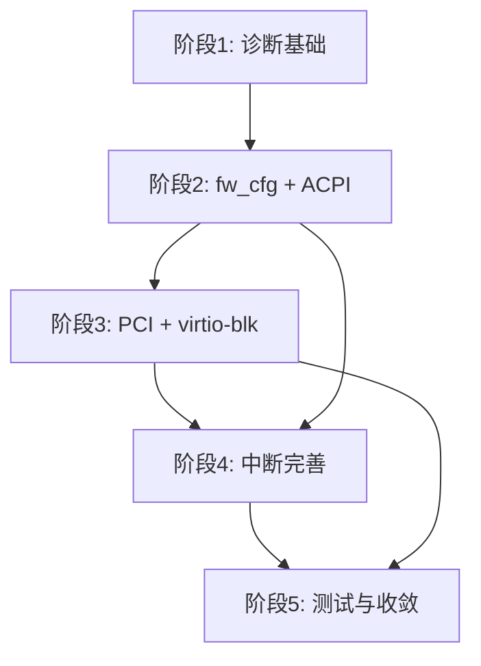

# AxVisor x86_64 Guest UEFI 支持 — 设计方案

> 基线：`dev` 分支当前 HEAD（`47c044f7d`）。
> 风险等级：**高风险功能**（涉及硬件协议、MMIO/DMA/IRQ、页表、启动/虚拟化契约、跨 vCPU 并发、新 crate 边界和公共 API）。
> 本文为独立可评审的设计材料，按 `book/guideline/feature-development.md` 高风险功能要求编写。

## 1. 目标

### 1.1 问题

AxVisor 当前只能以传统 BIOS/multiboot 方式启动 x86_64 guest：

- 依赖自带的 `axvm-bios.bin` 固件，无法使用行业标准 OVMF/UEFI 固件；
- 没有 ACPI 表、PCI 总线和 virtio-pci 设备模型，guest 无法通过标准 PC 发现路径找到启动盘；
- vCPU 初始状态为实模式 trampoline，不区分传统 BIOS 和 UEFI 的启动语义；
- Linux 等主流 guest OS 的 UEFI 启动路径完全不可用。

**证据**：

- `os/axvisor/configs/vms/qemu/x86_64/nimbos-uefi-smp1.toml`：`emu_devices = []`，IOAPIC/HPET 仅穿透，无 ACPI/PCI/virtio 设备；
- `arch/x86_64/boot/mptable.rs`：x86 仅有 SMP MP 表（legacy），无 ACPI 表生成；
- `axvm-types/src/lib.rs:981`：`VirtioBlk/VirtioNet/VirtioConsole` 类型已定义，但 `axdevice/src/lib.rs:78` 注释掉了 `pub use virtio_dev::*`，无 DeviceFactory 实现；
- `.github/workflows/ci.yml:692-714`：x86 UEFI CI job 被整块注释；
- LoongArch 已有完整 ACPI + fw_cfg + PCI + virtio 的 UEFI 启动参考实现（`arch/loongarch64/boot/`），x86 侧完全缺失。

**受众**：

- AxVisor x86 平台开发者：需要可诊断的 UEFI 启动路径来开发和调试虚拟设备；
- Guest OS 集成者：需要标准 UEFI 环境来启动 Linux、NimbOS 和其他 UEFI 应用；
- CI 维护者：需要可复现的 UEFI 测试门禁。

### 1.2 使用场景

开发者构建包含固定 OVMF 固件和 rootfs 的 AxVisor 镜像后，执行：

```bash
cargo xtask test axvisor --test uefi/ovmf-entry
```

期望结果：AxVisor 启动指定 VM，OVMF 固件从 reset vector 进入 SEC 阶段，Guest COM1 输出 `VM[1] guest COM1 reached OVMF SEC: SecCoreStartupWithStack(`，测试通过。

最终场景（阶段 3 完成后）：

```bash
cargo xtask test axvisor --test uefi/qemu-nimbos
```

期望结果：OVMF 通过 ACPI 发现平台硬件、通过 PCI 枚举发现 virtio-blk 启动盘、加载 NimbOS EFI 应用，guest 自身输出 `usertests passed!`。

### 1.3 成功标准

1. 固定版本的 OVMF 固件在 AxVisor VMX 和 SVM 后端上稳定进入 SEC，Guest COM1 输出 VM-qualified SEC marker；
2. OVMF 通过 fw_cfg 获取 ACPI 表，推进到 DXE/BDS；
3. OVMF 通过 PCI 枚举发现 virtio-blk 设备，读取 ESP 并进入 UEFI Shell 或 EFI 应用；
4. Linux EFI stub 通过 virtio-blk 成功启动到 initramfs shell；
5. SMP guest（≥2 vCPU）通过 INIT/SIPI 成功启动；
6. 以上所有场景的测试在 CI 中为 gating。

### 1.4 非目标

- pflash 设备及 OVMF VARS 持久化（P1 阶段独立设计，见 §6.11）；
- Secure Boot、SMM、TPM、网络启动（PXE）；
- virtio-net、virtio-console 的完整实现（virtio-blk 优先）；
- LoongArch UEFI 功能（LoongArch 已有独立实现路径）；
- 热插拔、NUMA、SRAT。

### 1.5 不实现的代价

- x86_64 guest 只能通过非标准 BIOS/multiboot 路径启动，无法启动主流 Linux 发行版的 UEFI 安装镜像；
- 无法复用 OVMF 的 DXE 驱动生态（PCI 枚举、文件系统驱动、UEFI Shell 诊断）；
- 虚拟设备开发缺少标准固件的反馈循环：新设备是否正确暴露、中断是否到达、ACPI 表是否被解析，都没有标准 OVMF 作为"探针"；
- 与 LoongArch UEFI 路径的差距持续扩大，跨架构公共抽象无法收敛。

---

## 2. 资料检索与 prior art

### 2.1 项目内部检索

按 `book/guideline/feature-development.md` §4.1 要求，检查了以下项目内部资源：

| 检索范围 | 发现 | 结论 |
|----------|------|------|
| `axvmconfig` / `axvm-types` 的 `VMBootProtocol`、`EmulatedDeviceType` | `VMBootProtocol::Uefi`、`FwCfg`/`VirtioBlk`/`VirtioNet`/`VirtioConsole` 类型已存在 | 复用现有枚举，新增工厂实现和平台接入 |
| `axdevice` 的 `FwCfg`、`DeviceFactory`、`DeviceRuntime` | fw_cfg 核心传输层已完成（MMIO + DMA），DeviceFactory 注册机制已就绪 | 复用 fw_cfg 核心，新增 x86 PIO transport adapter |
| `x86_vlapic` 的 `EmulatedLocalApic`、`EmulatedIoApic`、`EmulatedPit`、`EmulatedSerialPort` | vLAPIC（EOI/IPI/Timer/LVT）、vIOAPIC（24 GSI）、PIT、COM1 均已实现 | 复用现有仿真，补全 INIT/SIPI/NMI/PIC |
| `x86_vcpu` 的 VMX/SVM backend、EPT/NPT、reset vector | `0xfffffff0` → CS:F000/IP:FFF0 已正确映射 | 复用现有 vCPU 入口 |
| `arch/x86_64/boot/mptable.rs` | 已有 SMP MP 表生成（LAPIC + IOAPIC + PCI INTx routing） | ACPI 表是 MP 表的替代/升级，INTx 路由值可复用 |
| `arch/x86_64/irq.rs` | host IRQ forwarding 框架（GSI lease、mask/re-arm、drain-before-run）已就绪 | 复用 `X86InterruptDomain`，新增 PIC/MSI 路由 |
| `arch/loongarch64/boot/acpi.rs`（878 行） | 完整 ACPI 表生成（RSDP/RSDT/FADT/MADT/SRAT/SPCR/MCFG + DSDT AML + QEMU loader） | 作为 x86 实现的**参考模板**，但表内容（MADT entry 类型、DSDT AML 设备树）为 arch-specific，不能直接复用 |
| `arch/loongarch64/boot/` 的 `GuestPlatform`、`probe.rs`、`fdt/` | 完整的平台发现→ACPI 构建→fw_cfg 注入→FDT 生成链路 | 整体架构可借鉴，x86 不需要 FDT 分支 |
| `test-suit/axvisor/uefi/qemu-nimbos/` | 已有 NimbOS UEFI 测试框架和 VM 配置 | 复用测试框架，更新 success_regex |
| `uefi/p0` 分支（52b2edc） | 旧 P0 实现（固定 OVMF profile、SEC observer、trace） | 功能意图可参考，但接口基线已过时（依赖已删除的 `AxVmDevices`），不直接复用代码 |
| `.github/workflows/ci.yml:692-714` | x86 UEFI CI job 被注释 | 阶段 1 恢复为 non-gating，阶段 5 升级为 gating |

### 2.2 外部规范与参考

按 `book/guideline/feature-development.md` §4.2 证据优先级检索：

| 规范 / 资料 | 版本 / 标识 | 与本方案相关的结论 |
|------------|------------|-------------------|
| UEFI Specification | 2.10 (§7.2, §7.5, §8, §10) | 固件从 reset vector 进入 SEC，依次通过 PEI、DXE、BDS；DXE 阶段通过 ACPI/PCI 发现硬件；BDS 通过 UEFI Boot Manager 选择启动项 |
| ACPI Specification | 6.5 (§5.2.5, §5.2.8, §5.2.9, §5.2.11, §5.2.12) | RSDP 含 XSDT 指针；XSDT 指向 FADT/MADT/MCFG 等表；MADT 含 LAPIC（type 0）、IOAPIC（type 1）、Interrupt Source Override（type 2）entry |
| PCI Firmware Specification | 3.3 (§4.1) | ECAM 基址和总线范围在 MCFG 中声明；每个 bus 的配置空间映射为 MMIO 窗口 |
| VirtIO Specification | 1.2 (§4.1, §4.2) | PCI transport 通过 PCI capability 链暴露 Common/Notify/ISR/Device CFG 结构；transport 与 device type（blk/net/console）分层 |
| Intel SDM | Vol.3 §10.4, §10.12, §11.9 | LAPIC 在 `0xFEE00000`，xAPIC/x2APIC 模式；IOAPIC 在 `0xFEC00000`；MSI address `0xFEE00000-0xFEEFFFFF`，data 含 vector + delivery mode + trigger mode |
| Intel SDM | Vol.3 §9.1.4 | x86 reset vector `0xFFFFFFF0`，CS=0xF000、CS.base=0xFFFF0000、RIP=0xFFF0 |
| EDK2 / OvmfPkg | `edk2-stable202605`，`OvmfPkg/OvmfPkgX64.dsc` | 4MB FD 布局：VARS 在 `0x0-0x84000`，CODE 在 `0x84000-0x400000`；CODE 映射到 `0xFFC84000-0xFFFFFFFF`，reset vector 落在 CODE 最后 16 字节 |
| QEMU q35 机型 | QEMU 9.2，`hw/i386/pc_q35.c`，`hw/pci-host/q35.c` | MCH 的 PCI 主桥在 bus 0 slot 0 function 0；PIRQA→GSI16, PIRQB→GSI17, PIRQC→GSI18, PIRQD→GSI19；ECAM 默认 `0xB0000000`（可重定位）；fw_cfg PIO 在 `0x510`/`0x511` |
| QEMU fw_cfg | `docs/specs/fw_cfg.rst`，`hw/nvram/fw_cfg.c` | PIO selector `0x510`、data `0x511`；DMA 通过 `0x514` 的 8 字节寄存器触发；file directory 结构为 4 字节 count + 每项 64 字节（size + selector + reserved + name） |
| qemu-x86_64-axvisor-uefi Ci job | tgoskits `ci.yml:692-714`（当前被注释） | 展示 CI 集成所需的基础命令和目标配置 |

---

## 3. 方案比较

按 `book/guideline/feature-development.md` §5 要求，比较以下方案：

| 维度 | 方案 A：保持现状 | 方案 B：扩展 MP 表路径 | 方案 C：最小 q35 ACPI（本方案） | 方案 D：全功能 q35 仿真 |
|------|:---:|:---:|:---:|:---:|
| **语义正确性** | — 无法启动 UEFI guest | 部分（MP 表仅覆盖中断，无 PCI/ACPI 发现） | 满足最小可行目标 | 完整 q35 兼容 |
| **架构适配** | 无变化 | 与现有 mptable.rs 一致，但不解决 ACPI 需求 | 每层只增加必要能力，复用 fw_cfg/DeviceFactory/vLAPIC | 需要完整的南桥/北桥/LPC/PM 仿真 |
| **接口代价** | 无 | `mptable.rs` 扩展为 ACPI 生成器（职责混乱） | 新增 `arch/x86_64/boot/acpi.rs`、`axdevice/src/pci/`、`axdevice/src/virtio/` | 新增大量 q35 设备模型和持久化接口 |
| **实现复杂度** | — | 低（但功能不完整） | 中等，分 5 阶段递进 | 极高，远超当前需求 |
| **兼容性** | 不变 | 不影响现有 BIOS 路径 | 不影响现有 BIOS 路径，UEFI 在新配置中 opt-in | 现有配置需要大量适配 |
| **可测试性** | — | 仅能验证 MP 表生成 | 每阶段有独立测试和退出条件 | 需要 q35 兼容性测试套件 |
| **演进成本** | 积累技术债务 | 后续仍需 ACPI，MP 表路径会成为废弃代码 | 阶段 5 抽取跨架构公共部分 | 过度投入，多数设备 guest 不使用 |

**选择方案 C**。理由：

- 方案 A 阻塞所有 UEFI 相关工作，代价不可接受；
- 方案 B 只解决中断路由，不解决设备发现（ACPI、PCI），UEFI guest 仍然无法找到启动盘；
- 方案 D 虽然有长期价值，但当前 AxVisor 没有需要全功能 q35 的 guest 场景。多数 OVMF 构建可以通过最小 ACPI 表集合 + 精简 PCI 主桥 + virtio-blk 进入 UEFI Shell。先实现最小集，后续按真实需求逐步加入更多设备能力；
- 方案 C 的每个阶段都产出可独立验证的能力增量（SEC 入口 → DXE → BDS → EFI 应用 → Linux），而不是等到全部完成后才能看到启动成功。

**放弃的**：全功能 q35 设备模型（SMBus、LPC、SATA、USB）。这些在 guest OS 通过 virtio-blk 启动后可以逐步加入。

**付出的代价**：阶段 2 生成的 ACPI DSDT AML 只包含 PCI0 和 COM1，后续新增设备（HPET 虚拟化、RTC）需要更新 DSDT；但 OVMF 在 DXE 阶段可以接受部分设备缺失，不影响核心启动路径。

---

## 4. dev 现状

### 4.1 已具备

**启动配置模型**
- `VMBootProtocol::Uefi` 枚举，TOML 解析 `boot_protocol = "uefi"`（`axvmconfig/src/lib.rs`）
- `uefi_firmware_path` / `bios_load_addr` 配置字段，arch 校验矩阵
- `load_uefi_from_configured_path()` 从文件系统加载固件（`arch/x86_64/boot/mod.rs:261`）
- x86 vCPU reset vector `0xfffffff0` → `CS:F000, IP:FFF0` 正确映射（`x86_vcpu/src/lib.rs:164`）

**fw_cfg 传输层**
- 完整的 QEMU 兼容 MMIO fw_cfg 设备：选择器/数据寄存器、DMA 传输、QEMU loader 协议（`axdevice/src/fw_cfg.rs`，995 行）
- `FwCfgAcpiBlobs` / `FwCfgPlatformConfig` 类型，ACPI/SMBIOS/memmap 文件目录
- `DeviceFactory` 注册、DMA grant、payload factory 均就绪

**已模拟的 x86 平台设备**
- COM1 串口（`x86_vlapic::EmulatedSerialPort`），PIO `0x3f8-0x3ff`
- PIT 定时器（`x86_vlapic::EmulatedPit`），PIO `0x40-0x61`
- vIOAPIC（`x86_vlapic::EmulatedIoApic`），MMIO `0xfec00000`
- 以上设备均通过 `DeviceFactory` 注册（`arch/x86_64/mod.rs:471`）

**中断链路**
- vLAPIC：xAPIC MMIO（`0xfee00000`）、x2APIC MSR、EOI 处理、IPI Fixed 模式、Timer（OneShot/Periodic/TSCDeadline）、全部 LVT 条目（`x86_vlapic/src/vlapic.rs`）
- vIOAPIC：24 个重定向表项、GSI 断言/向量查询/EOI 广播、level-triggered 中断（`x86_vlapic/src/vioapic.rs`）
- 完整的 host IRQ forwarding 框架：GSI lease、mask/re-arm、drain-before-run（`arch/x86_64/irq.rs`）
- `VmInterruptSender` 和每 vCPU 中断队列（`runtime/vcpus.rs`）

**LoongArch 参考实现**

完整的 x86 可参考链路：`GuestPlatform` 发现 → ACPI 表构建（878 行）→ fw_cfg 注入 → UEFI FDT 生成（`arch/loongarch64/boot/`）。ACPI 表生成器包含 RSDP/RSDT/FADT/MADT/SRAT/SPCR/MCFG + DSDT AML（PCI0 设备含 `_PRT` 路由表、COM1 设备、PCI 资源描述）+ QEMU loader 协议。x86 实现可以复用相同的 fw_cfg 传输层、QEMU loader 协议和 ACPI blob 容器，只需替换 arch-specific 的表内容。

### 4.2 当前缺口

**阻塞性缺失（固件无法完成平台发现）**

| # | 缺口 | 影响 |
|---|------|------|
| 1 | **x86 ACPI 表生成** | OVMF 在 DXE 阶段需要 ACPI 表来发现 LAPIC、IOAPIC、PCI 总线。当前 x86 仅有 SMP MP 表（`mptable.rs`），无 ACPI |
| 2 | **fw_cfg x86 接入** | fw_cfg 核心已实现（MMIO），但 x86 UEFI 启动路径没有注册 fw_cfg 设备。OVMF 需要通过 fw_cfg 获取 ACPI 表、kernel/cmdline/initrd |
| 3 | **PCI 主桥 + ECAM** | 无 PCI bus 0 设备模型、无配置空间处理。Guest 无法枚举 PCI 设备 |
| 4 | **virtio-pci 传输层** | `EmulatedDeviceType::VirtioBlk/Net/Console` 已定义，但无 DeviceFactory 实现和 virtio-pci capability 结构 |

**高优先级缺失（中断与多核）**

| # | 缺口 | 影响 |
|---|------|------|
| 5 | **i8259 PIC 仿真** | DXE/BDS 阶段的中断路由需要 PIC 作为基础。当前无 PIC 设备 |
| 6 | **vLAPIC INIT/SIPI** | `process_init_sipi` 为 stub，多 vCPU 启动不可用 |
| 7 | **vLAPIC NMI 注入** | `inject_nmi` 为 `unimplemented!()` |
| 8 | **MSI/MSI-X 拦截** | Guest MSI 写（`0xFEE00000-0xFEEFFFFF`）会触发 `ApicRegOffset::from(0)` 的 panic |

**后续完善**

| # | 缺口 | 影响 |
|---|------|------|
| 9 | **HPET 虚拟化** | 当前仅穿透，需虚拟 HPET 暴露给 ACPI |
| 10 | **RTC/CMOS 仿真** | UEFI 固件在早期可能访问 CMOS 获取内存大小 |
| 11 | **OVMF_VARS 支持** | 当前只加载 OVMF_CODE.fd。VARS 存储需在后续阶段建模为 flash |

---

## 5. 架构分析

### 5.1 层次与边界

本方案新增的能力分布在以下层次：

```text
axdevice/          （可复用设备模型——OS-neutral）
├── fw_cfg.rs      已存在：fw_cfg MMIO core + DMA + ACPI blob 容器
├── pci/           新增：PCI 主桥 + ECAM 配置空间（不依赖 OS）
├── virtio/        新增：virtio-pci transport + virtio-blk device
└── x86/pic.rs     新增：i8259 PIC（x86-only，PIO 设备）

axvm/arch/x86_64/  （x86 平台接入——依赖 axdevice）
├── boot/acpi.rs   新增：x86 ACPI 表生成器（含 DSDT AML）
├── boot/mod.rs    修改：fw_cfg 注册、ACPI 管线
├── mod.rs         修改：lifecycle hook、设备工厂注册
├── msi.rs         新增：MSI/MSI-X 地址拦截与翻译
└── irq.rs         修改：PIC IRQ 注入、中断风暴保护

x86_vlapic/        （已存在——vLAPIC/vIOAPIC/PIT/COM1 core）
└── vlapic.rs      修改：INIT/SIPI/NMI 补全
```

层次原则：

- `axdevice/` 中的 PCI 和 virtio 设备模型不依赖任何 OS 或平台类型，只通过 `DeviceFactory`、`DeviceBundle` 和 DMA grant 接入；
- `axvm/arch/x86_64/` 负责 x86 平台特有的 ACPI 内容生成和中断路由，是架构适配层；
- `x86_vlapic/` 保持 OS-neutral，只通过 `X86VlapicHostOps` trait 与宿主交互。

### 5.2 关键数据流

**固件加载与平台发现（阶段 1-2）**

```text
OVMF_CODE.fd (文件系统)
    → load_uefi_from_configured_path()
    → 写入 guest 物理内存 [0xffc84000, 0x100000000)
    → vCPU reset vector 0xfffffff0 落在该窗口
    → OVMF SEC → PEI → DXE
    → DXE 阶段通过 fw_cfg PIO (0x510/0x511) 获取 ACPI 表
    → FwCfg 设备返回 ACPI blob（RSDP → XSDT → FADT/MADT/MCFG/DSDT）
    → OVMF 解析 ACPI 表，发现 LAPIC/IOAPIC/PCI 总线
```

**PCI 枚举与 virtio 启动盘（阶段 3）**

```text
OVMF DXE → PCI 枚举
    → ECAM MMIO 读 (bus 0, device N, function 0, offset 0)
    → PciHostBridge 设备解码 ECAM 地址
    → 返回 VendorID/DeviceID（virtio-blk: 0x1AF4/0x1042）
    → OVMF 读 PCI capability 链
    → VirtioPciDevice 返回 Common/Notify/ISR/Device CFG 结构
    → OVMF 初始化 virtqueue，读 ESP，加载 EFI 应用
```

**中断投递路径（阶段 4）**

```text
virtio-blk 完成 IO 请求
    → (MSI 路径) Guest 写 MSI address/data 到 0xFEE00000-0xFEEFFFFF
    → VM exit (EPT violation 或 APIC-access)
    → msi.rs 解析 address (dest_id) 和 data (vector, delivery_mode)
    → vLAPIC accept_interrupt(vector, edge)
    → vCPU 注入中断
    → (INTx 路径) virtio-pci 拉低 INTx#
    → vIOAPIC assert_gsi(gsi) → IoApicInterrupt
    → vLAPIC LINT0/LINT1 或直接注入
    → vCPU 注入中断
```

### 5.3 并发与锁

本方案引入的主要并发状态：

| 状态 | 所有者 | 共享方式 | 锁策略 |
|------|--------|---------|--------|
| PCI ECAM 配置空间 | `PciHostBridge`（VM 级） | 多 vCPU 可能同时访问不同 bus/device | `SpinNoIrq`，每个 access 持锁时间仅限于单次 MMIO 读写 |
| virtio-blk virtqueue | `VirtioBlk`（VM 级） | vCPU 提交请求，设备侧处理完成 | virtqueue 的 avail/used ring 通过内存序同步；设备侧不持锁等待 IO |
| i8259 PIC 状态（IMR/IRR/ISR） | `Pic`（VM 级） | vCPU PIO 访问 + vIOAPIC EOI 级联 | `SpinNoIrq`，PIO handler 不回调外部 |
| MSI 路由表 | `MsiRouter`（VM 级） | vCPU MSI 写 + 设备中断注入 | 读写锁，MSI 写为读侧（高频），路由变更为写侧（低频） |
| vLAPIC SIPI pending | per-vCPU | 发起 vCPU 写 ICR → 目标 vCPU 读 | 通过 `VmInterruptSender` 消息队列，无共享锁 |

**锁顺序**（从外到内）：

```text
DeviceRuntime::dispatch()
    → 可能持 Device 内部锁（PciHostBridge、Pic、VirtioBlk）
    → 中断注入 → vLAPIC accept_interrupt
    → VmInterruptSender → vCPU pending queue
    → 不回调其他 Device 锁（避免 ABBA）
```

关键约束：Device handler 内部持锁时不应触发其他 Device 的 bus access 或 interrupt injection（避免重入和死锁）。virtio-blk 的 IO 完成后通过异步 callback 注入中断，不在 virtqueue handler 内部直接调用 `VmInterruptSender`。

### 5.4 错误路径

| 场景 | 行为 |
|------|------|
| OVMF 访问未注册的 PIO/MMIO 地址 | `DeviceRuntime` 返回 `DeviceError::NotFound`，不伪造返回值。VM exit 记录到 trace |
| fw_cfg 收到未支持的 selector | `FwCfg` 返回空 entry（`FwCfgEntry::Bytes(&[])`），不 panic |
| PCI ECAM 读不存在的 device/function | 返回 `0xffffffff`，PCI 标准语义 |
| virtio-blk 读超出磁盘镜像边界 | 返回 virtio error status（`VIRTIO_BLK_S_IOERR`），不 panic |
| guest 写 MSI address 但未命中任何已注册路由 | Trace 记录，静默丢弃（与物理硬件行为一致） |
| 固件访问未实现的 ACPI 方法（DSDT AML） | AML interpreter 返回 0，不阻塞其他方法执行 |
| virtio DMA 传输中 guest reset | DMA grant 标记为 invalid，后续访问被拒绝 |

---

## 6. 关键设计决策

1. **LoongArch `boot/acpi.rs` 作为 x86 的模板，但独立实现**。两架构共享 fw_cfg 传输层、QEMU loader 协议和 ACPI blob 容器（已存在于 `axdevice`），但 ACPI 表内容为 arch-specific：x86 需要 LAPIC/IOAPIC/Override entry（MADT）、IO 端口资源描述（DSDT）、PIC 相关声明，LoongArch 需要 EIOINTC/PCH-PIC/MSI entry 和 FDT 生成。共享传输层、独立表内容。

2. **fw_cfg PIO transport 是 adapter，不是重写**。`axdevice/src/fw_cfg.rs` 的核心（selector 解析、DMA 引擎、文件目录构建）完全复用。x86 只需一个 PIO bus 到内部 MMIO register 的薄 adapter，通过 `DeviceFactory` 注册为 `BusKind::Port` 设备。

3. **PCI 和 virtio 通过统一设备框架接入**。PCI 主桥、virtio-pci transport、virtio-blk 各为一个 `DeviceFactory`，通过 `DeviceBundle` 声明资源（MMIO/PIO range、DMA grant、typed service），不新增旁路或绕过 `DeviceRuntime` 的访问路径。

4. **中断状态按 VM 所有，不引入全局状态**。i8259 PIC、MSI/MSI-X 路由均通过 `X86InterruptDomainKey` 和 `VmInterruptSender` 注入，不恢复旧式按 VM ID 查全局 forwarding state 的轮询模式。

5. **Guest COM1 作为阶段判定的可信数据源**。成功判定始终来自目标 VM 的 Guest COM1 输出（VM-qualified marker），不依赖宿主日志混合匹配。每个 OVMF 阶段 marker 的首次出现即为该阶段的进入证据。

6. **每个阶段不能"跳跃"**。如果 SEC marker 出现但 PEI marker 缺失，不能说"PEI 大概过了"。Trace 中的第一个未支持访问是下一阶段的优先级输入，不伪造返回值来模拟通过。

7. **模块边界按 §5.1 分层**。`axdevice/pci/ecam.rs` 隔离 ECAM 地址解码（纯数学映射），`axdevice/pci/mod.rs` 管理 bus/device 拓扑和 BAR 分配，`axdevice/virtio/` 实现 transport 和 device type 两层。新增文件均满足 guideline §8 的抽象条件：隔离平台差异（x86 PCI 寄存器布局）、存在确定的多实现边界（virtio-blk vs virtio-net vs 未来的 virtio-console）、隔离外部依赖（disk 后端）。

---

## 7. 实现路径

### 阶段 1：诊断基础 — 固件入口验证

**目标**：建立可复现、可归因的诊断链，让每次 UEFI 启动都能确定 OVMF 走到了哪一步。

**为什么是第一步**：后续 ACPI、PCI、virtio 等设备实现时，需要精确知道"OVMF 接下来访问了什么"，而不是靠猜。

**工作项**：

1. **固定 OVMF profile**：选定 `edk2-stable202605`、`OvmfPkg/OvmfPkgX64.dsc`、DEBUG、GCC、4MB FD、`DEBUG_ON_SERIAL_PORT`、`BUILD_SHELL=TRUE`。记录 CODE 布局（`0xffc84000-0xffffffff`）和 SHA-256，不扫描发行版 `/usr/share/OVMF`。

2. **Guest COM1 阶段 observer**：在 COM1 字节流中识别 OVMF 阶段标记（`SecCoreStartupWithStack(` → `Platform PEIM Loaded` → `DXE IPL Entry` → `[BdsDxe]`）。输出带 VM ID 前缀，不与其他 VM 混淆。标记匹配基于 `edk2-stable202605` DEBUG 构建的已知输出格式。observer 通过 `ArchOps::before_first_run` 激活，`on_last_vcpu_exit` 清理。

3. **设备访问 trace**：在 `DeviceRuntime` 的统一访问路径上记录 `device=<name> bus=PIO|MMIO direction=read|write addr=<addr> width=<width> value=<value> result=<ok|error>`。对未注册资源返回 `DeviceError::NotFound`，不伪造返回值。覆盖 `dispatch()` 和 `handle_mmio_write_with_memory()` 两条路径。

4. **固件装载日志**：记录 profile 名、文件路径、SHA-256、大小、GPA 范围、reset vector。

5. **ovmf-entry 测试用例**：新增 `test-suit/axvisor/uefi/ovmf-entry/`，成功判定仅为 VM-qualified SEC marker。初始为 non-gating diagnostic。

**退出条件**：

| 条件 | 可观察证据 |
|------|-----------|
| 固定 OVMF 在 VMX 后端进入 SEC | Guest COM1 输出 `VM[1] guest COM1 reached OVMF SEC: SecCoreStartupWithStack(` |
| Trace 记录首个未支持的平台访问 | CI 日志中可定位到具体的 `device= bus= addr=` 行 |
| ovmf-entry 测试可运行 | `cargo xtask test axvisor --test uefi/ovmf-entry` 执行并报告结果 |

### 阶段 2：平台发现 — fw_cfg 与 ACPI

**目标**：OVMF 在 DXE 阶段发现平台硬件拓扑，推进到 BDS。

**工作项**：

1. **x86 fw_cfg PIO 接入**：复用 `FwCfg` 核心。q35 标准 fw_cfg 在 PIO `0x510`（selector）、`0x511`（data word）、`0x514`（DMA address，8 字节 big-endian）。新增 x86 PIO adapter 通过 `DeviceFactory` 注册为 `BusKind::Port` 设备。

2. **x86 ACPI 表生成**：新建 `arch/x86_64/boot/acpi.rs`，以 LoongArch `boot/acpi.rs` 为模板。生成表集合：

   | 表 | 关键字段 |
   |---|---------|
   | RSDP | 含 XSDT 指针（64 位地址），checksum |
   | XSDT | 指向 FADT/MADT/MCFG/DSDT 的指针数组 |
   | FADT | SMI_CMD=0, ACPI_ENABLE/DISABLE=0, SCI_INT=9, PM1a_CNT_BLK=0, x86 固件控制字段 |
   | MADT | 每 vCPU 一个 LAPIC entry（ACPI ID=vcpu_id, APIC ID=vcpu_id, flags=1 BSP/0 AP）；一个 IOAPIC entry（addr=0xfec00000, GSI base=0）；一个 IRQ0 override（source=0, GSI=2, flags=0）；一个 IRQ9 override（source=9, GSI=9, flags=0x000d level-active-low） |
   | MCFG | ECAM base=`0x20000000`, segment=0, bus start=0, bus end=255 |
   | DSDT | PCI0 设备（_HID PNP0A08, _CRS, _PRT, _CBA）+ COM1 设备（_HID PNP0501, _CRS） |

   所有表通过 QEMU table-loader 协议注册到 fw_cfg（`etc/acpi/tables`、`etc/acpi/rsdp`、`etc/table-loader`），checksum 正确计算。

3. **DSDT AML**：PCI0 INTx 路由表按 q35 标准：PIRQA→GSI16, PIRQB→GSI17, PIRQC→GSI18, PIRQD→GSI19。PCI0 `_CRS` 含 bus number resource（0-255）、IO resource（`0x6000-0xffff`）、32-bit MMIO resource（`0x80000000-0xbfffffff`）。

**退出条件**：

| 条件 | 可观察证据 |
|------|-----------|
| OVMF DXE 阶段加载 ACPI 表 | Trace 中可见 `fw_cfg` 设备和 `FW_CFG_ACPI_TABLES`/`FW_CFG_ACPI_RSDP` selector 的 DMA 读操作，且返回的 blob 不含全零填充 |
| OVMF 推进到 BDS | Guest COM1 输出 `VM[1] guest COM1: [BdsDxe]` |
| ACPI 表的 MCFG 和 MADT 被解析 | OVMF 日志出现 `MCFG base=0x20000000` 或 PCI 枚举相关消息（阶段 1 observer 扩展） |

### 阶段 3：PCI 与启动盘 — virtio-pci

**目标**：OVMF 通过 PCI 枚举发现 virtio-blk，读取 ESP 并进入 UEFI Shell。

**工作项**：

1. **PCI 主桥（`axdevice/src/pci/`）**：ECAM 地址解码 `addr = ecam_base + (bus << 20) + (device << 15) + (function << 12) + offset`。Vendor ID/Device ID 查表返回，不存在设备返回 `0xffff`。Command/Status/BAR/Capability Pointer 等基本寄存器读写。

2. **virtio-pci transport（`axdevice/src/virtio/pci.rs`）**：遵循 VirtIO 1.2 §4.1。PCI capability 链中暴露 Common CFG、Notify CFG、ISR CFG、Device CFG 四个结构。Queue Select/Size/Enable/MSIX Vector 等寄存器映射到对应 PCI BAR。

3. **virtio-blk（`axdevice/src/virtio/blk.rs`）**：一个 virtqueue（请求队列），capacity/block_size 等 device config。读取 host 磁盘镜像，guest memory 通过显式 DMA grant 访问。

4. **PCI INTx**：利用已有 vIOAPIC，按 `_PRT` 声明将 INTx 路由到 GSI。

**退出条件**：

| 条件 | 可观察证据 |
|------|-----------|
| OVMF 枚举到 virtio-blk | Guest COM1 或 trace 中出现 `VirtioBlk` 或 `0x1AF4/0x1042` 的 PCI config 读 |
| OVMF 能读 ESP 文件 | Guest COM1 出现 UEFI Shell 提示符或 EFI 应用加载消息 |
| NimbOS UEFI 启动到 guest 自身标记 | NimbOS 输出 `usertests passed!`（不再是宿主 `VM[1] boot success`） |

### 阶段 4：中断完善

**目标**：完整中断链路，包括 PIC、MSI/MSI-X、SMP。

**工作项**：

1. **i8259 PIC（`axdevice/src/x86/pic.rs`）**：双片级联（master `0x20-0x21`、slave `0xa0-0xa1`），ICW/OCW 初始化、IRQ 断言、优先级、masking、EOI。PIC slave 的 INT 输出连接到 PIC master 的 IRQ2。通过 `DeviceFactory` 注册为 PIO 设备。

2. **MSI/MSI-X 拦截（`arch/x86_64/msi.rs`）**：拦截 `0xFEE00000-0xFEEFFFFF` MMIO 写。解析 MSI address（`0xFEE00000 | (dest_id << 12)`）和 data（vector + delivery mode + trigger mode），转换为 vLAPIC 中断注入。PCI MSI-X 需要 MSI-X capability 和 BAR 在配置空间中声明。

3. **vLAPIC INIT/SIPI 补全**：`process_init_sipi` 通过 `VmInterruptSender` 发送 SIPI vector 到目标 vCPU。

4. **vLAPIC NMI 补全**：`inject_nmi` 将 NMI 注入目标 vCPU。

5. **中断风暴保护**：level-triggered 中断 EOI 后重新检查源状态，连续 3 次 re-assert 后插入退避延迟。

**退出条件**：

| 条件 | 可观察证据 |
|------|-----------|
| virtio-blk INTx/MSI 中断可投递 | virtio 请求完成，中断向量被 vCPU 接受（trace 中可见 `inject_interrupt`） |
| SMP 启动（≥2 vCPU） | Guest COM1 显示 BSP 和 AP 均已进入 OS |
| 重复 start/stop/reset 无状态泄漏 | 连续 5 次 VM reset 后，中断投递延迟不增长 |
| MSI 写不再 panic | 阶段 2 中先加 offset 0 的显式处理 |

### 阶段 5：测试与跨架构收敛

**目标**：完整测试覆盖，x86 与 LoongArch 公共部分抽取。

**工作项**：

1. **Linux EFI stub 启动测试**：新增 x86_64 Linux guest UEFI 启动测试，success_regex 为 guest initramfs shell prompt。

2. **HPET 虚拟化**：新建 `axdevice/src/x86/hpet.rs`，MMIO `0xfed00000`，至少一个 timer comparator。通过 `DeviceFactory` 注册。ACPI DSDT 中声明。

3. **RTC/CMOS 仿真**：最小 CMOS RTC（PIO `0x70-0x71`），支持内存大小扩展 CMOS 寄存器。

4. **公共部分抽取**：识别 `fw_cfg` 管线、ACPI blob 组装、QEMU loader 协议的两架构共用部分，抽取到 `axdevice/` 公共层。LoongArch 保留 FDT 路径。

5. **CI 门禁**：ovmf-entry 和 NimbOS UEFI 从 non-gating 升级为 gating，补全 `.github/workflows/ci.yml` 中注释的 x86 UEFI job。

**退出条件**：Linux 启动到 initramfs；HPET/RTC UEFI 可用；x86 UEFI CI gating。

---

## 8. 新增公共接口

每个阶段新增的公共接口汇总：

| 阶段 | 新增公共类型 / 接口 | 所属 crate | 说明 |
|------|-------------------|-----------|------|
| 2 | `FwCfgPioAdapter`（或复用现有 `FwCfg` + `BusKind::Port`） | `axdevice` | fw_cfg PIO transport adapter，实现 `Device` trait |
| 2 | `build_x86_acpi()` free function | `axvm` (arch private) | x86 ACPI 表生成入口，返回 `FwCfgAcpiBlobs` |
| 3 | `PciHostBridge` struct + `Device` impl | `axdevice` | PCI 主桥设备 |
| 3 | `VirtioPciDevice` struct + `Device` impl | `axdevice` | virtio-pci transport |
| 3 | `VirtioBlk` struct + `Device` impl | `axdevice` | virtio-blk device type |
| 4 | `Pic` struct + `Device` impl | `axdevice` | i8259 PIC 设备 |
| 4 | `MsiRouter` struct（arch private） | `axvm` | MSI/MSI-X 地址拦截与路由 |

**接口设计原则**：

- 所有新设备通过现有 `DeviceFactory` trait 注册，不新增 trait 方法；
- `EmulatedDeviceType` 枚举可能新增 `X86Pic` variant，但现有 variant 不修改；
- TOML VM 配置不新增公开字段，UEFI guest 配置沿用现有 `boot_protocol = "uefi"` + `uefi_firmware_path` + `bios_load_addr`；
- 错误类型：`axdevice` 中的 Device 返回 `DeviceError`（已有）；`arch/x86_64/` 中的平台代码返回 `AxVmError`（已有）。

---

## 9. 验证与测试

### 9.1 测试矩阵

| 功能声明 | 验证层级 | 命令/用例 | 可观察通过条件 | 阶段 |
|----------|---------|-----------|---------------|------|
| OVMF 固定 profile 进入 SEC | QEMU VMX/SVM | `cargo xtask test axvisor --test uefi/ovmf-entry-vmx` (同理 SVM) | Guest COM1 输出 VM-qualified `SecCoreStartupWithStack(` | 1 |
| 设备 trace 记录未支持访问 | 同上 | 同上 | CI 日志含 `device= bus= addr=` trace 行，首个 `result=NotFound` 后至少有一个后续 trace 行 | 1 |
| OVMF 通过 fw_cfg 获取 ACPI 表 | QEMU VMX | ovmf-entry 测试（扩展） | trace 含 `fw_cfg DMA read selector=0x23`（ACPI_TABLES），返回非零长度 | 2 |
| OVMF 进入 BDS | QEMU VMX | ovmf-entry 测试 | Guest COM1 输出 `[BdsDxe]` | 2 |
| OVMF PCI 枚举发现 virtio-blk | QEMU VMX | NimbOS UEFI 测试 | trace 含 `pci` device 的 config read，VendorID=0x1AF4 | 3 |
| NimbOS UEFI 完整启动 | QEMU VMX | `cargo xtask test axvisor --test uefi/qemu-nimbos` | NimbOS 输出 `usertests passed!` | 3 |
| virtio-blk MSI 中断投递 | QEMU VMX | NimbOS UEFI + trace | `inject_interrupt` 日志含 virtio-blk MSI vector | 4 |
| SMP UEFI 启动 | QEMU VMX | 新增 `uefi/qemu-nimbos-smp2` | `usertests passed!`，且至少 2 个 vCPU 的 COM1 有活跃输出 | 4 |
| Linux EFI stub 启动 | QEMU VMX | 新增 `uefi/qemu-linux-efi` | Guest COM1 输出 Linux kernel banner + initramfs shell prompt | 5 |
| 重复 VM reset 无中断泄漏 | QEMU VMX | 新增压力测试：连续 reset 5 次 | 每次 reset 后的首次 MSI 延迟与前次无统计显著差异 | 4 |
| 回归：BIOS/multiboot 不受影响 | QEMU VMX | 现有 direct VMX/SVM smoke | 与 dev 基线一致 | 1-5 |

### 9.2 测试失败模式

每个测试必须在对应行为损坏时确实失败：

- ovmf-entry：若 OVMF CODE 映射错误或 reset vector 未命中，Guest COM1 将无 SEC marker 输出，测试超时；
- ACPI 表缺失：OVMF DXE 阶段无法完成平台发现，不会输出 `[BdsDxe]` 或 `[BdsDxe]` 后立即挂起，测试超时；
- virtio-blk 缺失：OVMF BDS 无法找到 boot option，UEFI Shell 无输出或 NimbOS 不启动；
- 中断缺失：virtio-blk IO 请求完成后 guest 永远收不到中断，测试超时。

---

## 10. 阶段依赖关系



**数据依赖**：

- 阶段 2 依赖阶段 1 的 trace 输出确定 fw_cfg/ACPI 相关访问；
- 阶段 3 依赖阶段 2 的 MCFG/DSDT PCI0 声明（ECAM base、_PRT）；
- 阶段 4 MSI/MSI-X 依赖阶段 3 的 virtio-pci capability 结构和 PCI BAR 布局；
- 阶段 4 PIC 不依赖阶段 3，可在阶段 2 后并行开始；
- 阶段 5 的公共抽取依赖阶段 3-4 的接口稳定。

---

## 11. 风险

| 风险 | 可能性 | 影响 | 缓解 |
|------|:---:|------|------|
| 固定 OVMF 在 AxVisor 上无法进入 SEC | 低 | 阻塞阶段 1 | 先用标准 QEMU q35 验证同一固件可完成 SEC→BDS，排除固件自身问题；若 QEMU 通过而 AxVisor 不通过，是 vCPU/NPT 问题 |
| MSI 写触发 panic（`ApicRegOffset::from(0)` 无对应 arm） | 高 | 阻塞阶段 3+ | 阶段 2 先加 offset 0 显式处理（返回 0 + trace），避免 PCI 枚举时的意外 panic |
| vLAPIC SIPI 跨 vCPU 同步问题 | 中 | 阻塞阶段 4 SMP | 利用已有 `VmInterruptSender` 和 vCPU 消息队列，避免引入新同步原语；单 vCPU 场景不受影响 |
| OVMF 依赖 VARS store 查找 boot option | 中 | 可能阻塞阶段 3 UEFI Shell 入口 | OVMF 在 shell 编译开关开启时，即使无 VARS 也会进入 shell；若标准构建不进入 shell，可通过 fw_cfg 传递 `bootorder` 文件引导特定条目 |
| LoongArch DSDT AML 与 x86 q35 差异大 | 低 | 阶段 2 需独立验证 AML | 使用 `iasl` 反编译参考 QEMU 生成的 DSDT，验证 AML 结构 |
| ACPI 表 checksum 错误 | 中 | OVMF 在 DXE 阶段拒绝加载表 | 阶段 2 编写 `iasl` 验证脚本，CI 中自动校验生成的表 |

---

## 12. 上线、回滚与可观测性

- **启用**：通过 VM 配置中 `boot_protocol = "uefi"` opt-in，不影响默认 BIOS/multiboot 路径；
- **禁用**：将 `boot_protocol` 改回 `"multiboot"` 或 `"direct"`，无需重新编译 AxVisor；
- **确认功能在使用**：Guest COM1 trace 中出现 VM-qualified marker、loader 日志中的 `boot_protocol=uefi` 行；
- **回滚**：UEFI 路径完全 opt-in，回滚只影响特定 VM 配置，不影响其他 VM 或 AxVisor 自身运行；
- **可观测信号**：Guest COM1 阶段 marker（SEC/PEI/DXE/BDS/OS）、device access trace、fw_cfg DMA log、MSI 拦截 log；
- **回滚触发条件**：OVMF 无法进入 SEC、PCI 枚举失败导致 BDS 超时、中断风暴；
- **外部固件依赖不可用**：若 tgosimages 上的 OVMF bundle 不可达，setup 脚本报告明确错误，不静默 fallback 到发行版 OVMF。

---

## 13. 变更落点总览

| 阶段 | 新增 | 修改 |
|------|------|------|
| 1 | `test-suit/axvisor/uefi/ovmf-entry/`、OVMF profile 管理脚本 | `arch/x86_64/boot/mod.rs`、`arch/x86_64/mod.rs`、`axdevice/src/device.rs`、`.github/workflows/ci.yml` |
| 2 | `arch/x86_64/boot/acpi.rs`、`arch/x86_64/boot/acpi/dsdt.rs` | `arch/x86_64/boot/mod.rs`、`arch/x86_64/mod.rs`、`axdevice/src/fw_cfg.rs`（PIO adapter） |
| 3 | `axdevice/src/pci/mod.rs`、`axdevice/src/pci/ecam.rs`、`axdevice/src/virtio/pci.rs`、`axdevice/src/virtio/blk.rs` | `arch/x86_64/boot/acpi/`（DSDT 更新）、VM 配置 toml |
| 4 | `axdevice/src/x86/pic.rs`、`arch/x86_64/msi.rs` | `x86_vlapic/src/vlapic.rs`、`x86_vcpu/`（EPT MSI range）、`arch/x86_64/irq.rs` |
| 5 | Linux EFI 测试、HPET/RTC 设备 | CI workflow、`axdevice/src/x86/hpet.rs`、公共层抽取 |
