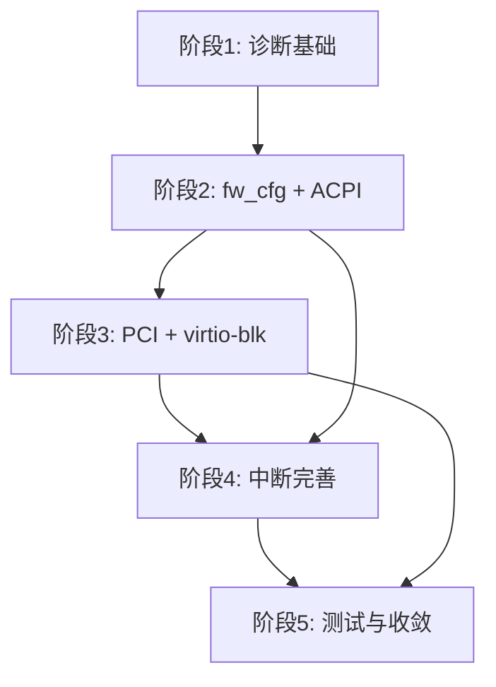

# AxVisor x86_64 Guest UEFI 支持 — 设计方案

> 基线：`dev` 分支当前 HEAD（`47c044f7d`）。
> 本文描述从 dev 现状出发，逐步实现标准 x86_64 UEFI guest 启动的完整路线。

## 1. 目标

让 AxVisor 能够启动标准的 x86_64 UEFI guest，使用 OVMF 作为固件、通过 ACPI/PCI 发现硬件、从 virtio-blk 启动盘加载 OS。

### 1.1 终态

- OVMF 固件从 reset vector 进入，依次通过 SEC、PEI、DXE、BDS 阶段
- Guest 通过 ACPI 表发现 LAPIC、IOAPIC、HPET、PCI 总线等平台硬件
- Guest 通过 PCI 枚举发现 virtio-blk 启动盘，读取 ESP 并加载 EFI 应用或 Linux EFI stub
- 中断链路完整：i8259 PIC、vIOAPIC INTx、MSI/MSI-X 均可投递
- SMP guest 通过 INIT/SIPI 启动 secondary vCPU

### 1.2 非目标

以下能力不在本设计的范围内，留待后续独立设计：
- pflash 设备及 OVMF VARS 持久化
- Secure Boot、SMM、TPM
- 网络启动（PXE）、virtio-net、virtio-console 的完整实现
- LoongArch UEFI 功能（LoongArch 已有独立实现路径）
- 热插拔、NUMA、SRAT

### 1.3 用户与成功标准

主要用户是 AxVisor x86 平台开发者和 guest OS 集成者。

- 固定版本的 OVMF 固件在 AxVisor 上稳定进入 SEC
- Guest COM1 输出作为固件阶段判定的可信来源
- Device trace 记录首个未支持的平台访问，指导后续设备实现
- Linux EFI stub 通过 virtio-blk 成功启动到 initramfs shell

---

## 2. dev 现状

### 2.1 已具备

**启动配置模型**
- `VMBootProtocol::Uefi` 枚举，TOML 解析 `boot_protocol = "uefi"`（`axvmconfig/src/lib.rs`）
- `uefi_firmware_path` / `bios_load_addr` 配置字段，arch 校验矩阵
- `load_uefi_from_configured_path()` 从文件系统加载固件（`arch/x86_64/boot/mod.rs:261`）
- x86 vCPU reset vector `0xfffffff0` → `CS:F000, IP:FFF0` 正确映射（`x86_vcpu/src/lib.rs:164`）

**fw_cfg 传输层**
- 完整的 QEMU 兼容 MMIO fw_cfg 设备：选择器/数据寄存器、DMA 传输、QEMU loader 协议（`axdevice/src/fw_cfg.rs`，995 行）
- `FwCfgAcpiBlobs` / `FwCfgPlatformConfig` 类型，ACPI/SMBIOS/memmap 文件目录
- `DeviceFactory` 注册、DMA grant、payload factory 均就绪

**已模拟的 x86 平台设备**
- COM1 串口（`x86_vlapic::EmulatedSerialPort`），PIO `0x3f8-0x3ff`
- PIT 定时器（`x86_vlapic::EmulatedPit`），PIO `0x40-0x61`
- vIOAPIC（`x86_vlapic::EmulatedIoApic`），MMIO `0xfec00000`
- 以上设备均通过 `DeviceFactory` 注册（`arch/x86_64/mod.rs:471`）

**中断链路**
- vLAPIC：xAPIC MMIO（`0xfee00000`）、x2APIC MSR、EOI 处理、IPI Fixed 模式、Timer（OneShot/Periodic/TSCDeadline）、全部 LVT 条目（`x86_vlapic/src/vlapic.rs`）
- vIOAPIC：24 个重定向表项、GSI 断言/向量查询/EOI 广播、level-triggered 中断（`x86_vlapic/src/vioapic.rs`）
- 完整的 host IRQ forwarding 框架：GSI lease、mask/re-arm、drain-before-run（`arch/x86_64/irq.rs`）
- `VmInterruptSender` 和每 vCPU 中断队列（`runtime/vcpus.rs`）

**LoongArch 参考实现**
- 完整的 x86 可参考链路：`GuestPlatform` 发现 → ACPI 表构建（878 行，含 RSDP/RSDT/FADT/MADT/SRAT/SPCR/MCFG + DSDT AML + QEMU loader）→ fw_cfg 注入 → UEFI 固件 FDT 生成（`arch/loongarch64/boot/`）

**测试框架**
- NimbOS UEFI test-suit 目录存在（`test-suit/axvisor/uefi/qemu-nimbos/`）
- x86_64 UEFI VM 配置示例（`os/axvisor/configs/vms/qemu/x86_64/nimbos-uefi-smp1.toml`）

### 2.2 当前缺口

下面按对标准 UEFI 启动的影响程度排列：

**阻塞性缺失（固件无法完成平台发现）**

| # | 缺口 | 影响 |
|---|------|------|
| 1 | **x86 ACPI 表生成** | OVMF 在 DXE 阶段需要 ACPI 表（至少 RSDP/XSDT/FADT/MADT/MCFG）来发现 LAPIC、IOAPIC、PCI 总线。当前 x86 仅有 SMP MP 表（`mptable.rs`），无 ACPI |
| 2 | **fw_cfg x86 接入** | fw_cfg 核心已实现（MMIO），但 x86 UEFI 启动路径没有注册 fw_cfg 设备。OVMF 需要通过 fw_cfg 获取 ACPI 表、kernel/cmdline/initrd 等信息 |
| 3 | **PCI 主桥 + ECAM** | 无 PCI bus 0 的设备模型、无配置空间处理、无 BAR 分配。Guest 无法枚举 PCI 设备 |
| 4 | **virtio-pci 传输层** | `EmulatedDeviceType::VirtioBlk/Net/Console` 已定义，但无 DeviceFactory 实现和 virtio-pci capability 结构 |

**高优先级缺失（中断与多核）**

| # | 缺口 | 影响 |
|---|------|------|
| 5 | **i8259 PIC 仿真** | 固件在 APIC 初始化前依赖传统 PIC。OVMF SEC/PEI 阶段可能不直接访问 PIC 端口，但 DXE/BDS 的中断路由需要它 |
| 6 | **vLAPIC INIT/SIPI** | `process_init_sipi` 为 stub，多 vCPU 启动不可用 |
| 7 | **vLAPIC NMI 注入** | `inject_nmi` 为 `unimplemented!()` |
| 8 | **MSI/MSI-X 拦截** | Guest MSI 写（`0xFEE00000-0xFEEFFFFF`）会触发 `ApicRegOffset::from(0)` 的 `unreachable!` panic |

**后续完善**

| # | 缺口 | 影响 |
|---|------|------|
| 9 | **HPET 虚拟化** | 当前仅穿透，需虚拟 HPET 暴露给 ACPI |
| 10 | **RTC/CMOS 仿真** | UEFI 固件在早期可能访问 CMOS 获取内存大小等信息 |
| 11 | **OVMF_VARS 支持** | 当前只加载 OVMF_CODE.fd。VARS 需要在 P1 阶段建模为 flash |

---

## 3. 实现路径

整体分为五个阶段。每个阶段有明确的退出条件和依赖关系。

### 阶段 1：诊断基础 — 固件入口验证

**目标**：建立一条可复现、可归因的诊断链，让每次 UEFI 启动都能确定"OVMF 走到了哪一步"。

**为什么这是第一步**：后续 ACPI、PCI、virtio 等设备实现时，需要精确知道"OVMF 接下来访问了什么"，而不是靠猜。没有诊断基础，后续调试会陷入"改了代码但不确定固件是否走到了相关路径"的困境。

**工作项**：

1. **固定 OVMF profile**：选定一个 EDK2 版本和构建参数（推荐 `edk2-stable202605`、`OvmfPkg/OvmfPkgX64.dsc`、DEBUG、GCC、4MB FD、`DEBUG_ON_SERIAL_PORT`、`BUILD_SHELL=TRUE`），记录 CODE 布局和哈希。不再扫描发行版 `/usr/share/OVMF`。

2. **Guest COM1 阶段 observer**：利用已有的 COM1 串口设备，在字节流中识别 OVMF 阶段标记（`SecCoreStartupWithStack(`、`Platform PEIM Loaded`、`DXE IPL Entry`、`[BdsDxe]`）。每个标记输出带 VM ID 前缀，不与其他 VM 或宿主日志混淆。

3. **设备访问 trace**：在 `DeviceRuntime` 的统一访问路径上记录 `device=<name> bus=PIO|MMIO direction=read|write addr=<addr> width=<width> value=<value> result=<ok|error>`。对未注册资源返回 `DeviceError::NotFound`，不伪造返回值。

4. **OBMF 固件装载日志**：记录 profile 名、文件路径、SHA-256、大小、GPA 范围、reset vector。

5. **OVMF entry 测试用例**：新增 `test-suit/axvisor/uefi/ovmf-entry/`，成功判定仅为 VM-qualified SEC marker，不接受宿主日志 `VM[1] boot success`。初始为非门禁 diagnostic。

**退出条件**：
- 固定 OVMF profile 在 AxVisor VMX 后端上进入 SEC，Guest COM1 输出 `VM[1] guest COM1 reached OVMF SEC: SecCoreStartupWithStack(`
- Trace 记录 SEC 后第一个未支持的平台访问（这是阶段 2 的输入）
- CI 中 ovmf-entry 测试可运行（non-gating）

**涉及文件**：
- `os/axvisor/scripts/` — OVMF profile 管理脚本
- `virtualization/axvm/src/arch/x86_64/boot/mod.rs` — 固件装载日志
- `virtualization/axvm/src/arch/x86_64/mod.rs` — lifecycle hook 与 COM1 observer
- `virtualization/axdevice/src/device.rs` — DeviceRuntime trace
- `test-suit/axvisor/uefi/ovmf-entry/` — 新增测试

---

### 阶段 2：平台发现 — fw_cfg 与 ACPI

**目标**：让 OVMF 在 DXE 阶段发现平台硬件拓扑，稳定推进到 BDS。

**为什么这是第二步**：阶段 1 的 trace 会告诉我们需要实现哪些平台设备。预期结果显示 OVMF 在 SEC 后会尝试访问 fw_cfg、ACPI 表，这是本阶段的工作。

**工作项**：

1. **x86 fw_cfg 接入**：复用现有 `FwCfg` 核心（`axdevice/src/fw_cfg.rs`）。x86 q35 的 fw_cfg 通常位于 PIO `0x510`/`0x511` 或 MMIO。选择 PIO 方式（更接近 q35 标准行为），新增 x86 PIO transport adapter，通过 `DeviceFactory` 注册。核心逻辑不变。

2. **x86 ACPI 表生成**：以 LoongArch `boot/acpi.rs` 为模板，新建 `arch/x86_64/boot/acpi.rs`。最少需要：
   - **RSDP**（含 XSDT 指针）
   - **XSDT**（指向所有表的指针数组）
   - **FADT**（x86 固件 ACPI 控制寄存器、PM 定时器、SCI 中断等字段）
   - **MADT**：每个 vCPU 一个 LAPIC entry（ACPI ID、APIC ID、flags）、一个 IOAPIC entry（地址 `0xfec00000`、GSI base 0）、ISA IRQ 0 的 interrupt source override（IRQ0→GSI2）
   - **MCFG**：ECAM 基址和总线范围（为阶段 3 准备）
   - 所有表通过 QEMU table-loader 协议注册到 fw_cfg（`etc/acpi/tables`、`etc/acpi/rsdp`、`etc/table-loader`）

3. **DSDT AML**：生成最小 DSDT，含 PCI0 设备（`_HID PNP0A08`、`_CRS` 含 bus/MMIO/IO 资源、`_PRT` INTx 路由表、`_CBA` ECAM 基址）。PCI INTx 路由按 q35 标准：PIRQA→GSI16、PIRQB→GSI17、PIRQC→GSI18、PIRQD→GSI19。

4. **fw_cfg → ACPI 管线集成**：x86 启动路径调用 ACPI 构建，将 `FwCfgAcpiBlobs` 和 `FwCfgPlatformConfig` 传递给 `FwCfgDeviceFactory`。

**退出条件**：
- OVMF DXE 阶段加载 ACPI 表，MADT/MCFG/DSDT 通过 fw_cfg 成功获取
- OVMF 推进到 BDS（`[BdsDxe]` 出现在 Guest COM1）
- Trace 中没有因缺失 ACPI 表或 fw_cfg selector 导致的错误

**涉及文件**（新增/修改）：
- `virtualization/axvm/src/arch/x86_64/boot/acpi.rs` — 新增，x86 ACPI 表生成
- `virtualization/axvm/src/arch/x86_64/boot/mod.rs` — ACPI 管线集成
- `virtualization/axvm/src/arch/x86_64/boot/acpi/dsdt.rs` — 新增，x86 DSDT AML
- `virtualization/axdevice/src/fw_cfg.rs` — PIO transport adapter（如需要）
- `virtualization/axvm/src/arch/x86_64/mod.rs` — fw_cfg 设备注册

---

### 阶段 3：PCI 与启动盘 — virtio-pci

**目标**：OVMF 通过 PCI 枚举发现 virtio-blk 设备，读取 ESP 并进入 UEFI Shell 或加载 EFI 应用。

**工作项**：

1. **PCI 主桥设备**：实现 `PciHostBridge`，管理 bus 0 的 ECAM 配置空间（MMIO 窗口 `0x20000000` 起始）。最小实现：
   - ECAM 地址解码（bus/device/function/offset → MMIO 地址）
   - Vendor ID / Device ID 读取（`0xffff` 表示不存在，否则返回实际值）
   - Command / Status / BAR / Capability Pointer 等基本寄存器
   - 通过 `DeviceFactory` 注册

2. **virtio-pci 传输层**：实现 `VirtioPciDevice`，遵循 VirtIO 1.0 PCI 布局：
   - Common CFG（`VIRTIO_PCI_CAP_COMMON_CFG`）：device_feature、device_status、queue_select、queue_enable 等
   - Notify CFG（`VIRTIO_PCI_CAP_NOTIFY_CFG`）：queue_notify
   - ISR CFG（`VIRTIO_PCI_CAP_ISR_CFG`）：中断状态
   - Device CFG（`VIRTIO_PCI_CAP_DEVICE_CFG`）：设备特定配置
   - PCI capabilities 在配置空间中声明

3. **virtio-blk 设备**：实现 `VirtioBlk`，通过 virtio-pci 暴露：
   - 一个 virtqueue（请求队列）
   - capacity、block_size 等设备配置
   - 读取 host 磁盘镜像文件，处理读写请求
   - Guest memory 访问通过显式 DMA grant

4. **PCI INTx 中断**：利用已有的 vIOAPIC，将 PCI INTx（INTA#/INTB#/INTC#/INTD#）路由到对应的 GSI。按 q35 标准：slot 0 的 INTA# 连接到 PIRQA（GSI16），通过 `_PRT` 在 ACPI DSDT 中声明。

**退出条件**：
- OVMF DXE 阶段通过 PCI 枚举发现 virtio-blk 设备
- OVMF BDS 阶段能读取 ESP 上的文件
- 能从 ESP 加载并进入 UEFI Shell 或 NimbOS EFI 应用
- NimbOS UEFI 测试的 success_regex 改为 guest 自身标记（`usertests passed!`）

**涉及文件**（新增/修改）：
- `virtualization/axdevice/src/pci/mod.rs` — 新增，PCI 主桥
- `virtualization/axdevice/src/pci/ecam.rs` — 新增，ECAM 配置空间
- `virtualization/axdevice/src/virtio/pci.rs` — 新增，virtio-pci 传输层
- `virtualization/axdevice/src/virtio/blk.rs` — 新增，virtio-blk 设备
- `virtualization/axvm/src/arch/x86_64/boot/acpi/dsdt.rs` — PCI0 AML（已在阶段 2 准备）
- `os/axvisor/configs/vms/qemu/x86_64/` — 更新 UEFI VM 配置

---

### 阶段 4：中断完善

**目标**：完整的中断链路，包括 PIC、MSI/MSI-X、SMP。

**工作项**：

1. **i8259 PIC 仿真**：实现双 PIC 级联（master `0x20-0x21`、slave `0xa0-0xa1`），支持 ICW/OCW 初始化、IRQ 断言、优先级、masking、EOI。PIC 输出连接到 vLAPIC LINT0（ExtINT 模式）或 vIOAPIC。通过 `DeviceFactory` 注册为 PIO 设备。

2. **vLAPIC INIT/SIPI**：补全 `process_init_sipi`，实现 secondary vCPU 的启动流程。INIT 重置 vCPU 状态，SIPI 将启动向量发送到目标 vCPU。依赖 `VmInterruptSender` 和 runtime dispatcher 进行跨 vCPU 通信。

3. **vLAPIC NMI 注入**：补全 `inject_nmi`，实现 NMI delivery 到目标 vCPU。

4. **MSI/MSI-X 拦截**：拦截 guest 对 `0xFEE00000-0xFEEFFFFF` 地址范围的 MMIO 写。解析 MSI address（`0xFEE00000 | (dest_id << 12)`）和 data（vector、delivery mode、trigger mode）。将解析结果转换为 vLAPIC 中断注入。PCI MSI-X 需要在配置空间中暴露 MSI-X capability 和 BAR。

5. **中断风暴保护**：对 level-triggered 中断实现 re-injection 退避，防止同一 GSI 反复触发导致 vCPU 无法前进。

**退出条件**：
- INTx（PIC→vIOAPIC→vLAPIC）中断链路可投递
- virtio-blk 的 MSI/MSI-X 中断可触发
- SMP guest（≥2 vCPU）通过 INIT/SIPI 成功启动
- 重复 start/stop/reset 无中断状态泄漏

**涉及文件**：
- `virtualization/axdevice/src/x86/pic.rs` — 新增，i8259 PIC
- `virtualization/x86_vlapic/src/vlapic.rs` — INIT/SIPI/NMI 补全
- `virtualization/axvm/src/arch/x86_64/msi.rs` — 新增，MSI/MSI-X 拦截
- `virtualization/x86_vcpu/src/vmx/vcpu.rs` — MSI 地址空间 EPT 映射
- `virtualization/axvm/src/arch/x86_64/irq.rs` — 中断风暴保护

---

### 阶段 5：测试与跨架构收敛

**目标**：完整的测试覆盖，x86 与 LoongArch UEFI 路径的公共部分提取。

**工作项**：

1. **Linux EFI stub 启动测试**：新增 x86_64 Linux guest 的 UEFI 启动测试。Guest 通过 OVMF → Linux EFI stub → virtio-blk 启动到 initramfs shell。success_regex 为 guest 自身输出。

2. **HPET 虚拟化**：替代当前的穿透模式。HPET 作为 ACPI 表中的一个设备暴露，至少支持一个 timer 用于 guest 时间管理。

3. **RTC/CMOS 仿真**：最小 CMOS RTC 实现，支持 OVMF 读取内存大小等启动参数。

4. **x86/LoongArch 公共抽取**：在 x86 ACPI 路径稳定后，识别两架构共用部分（fw_cfg 管线、ACPI blob 组装、QEMU loader 协议），抽取到 `axvm/src/boot/` 或 `axdevice/` 公共层。LoongArch 保留其平台特有的设备拓扑和 FDT 路径。

5. **CI 门禁**：`ovmf-entry` 和 NimbOS UEFI 测试从 non-gating 升级为 gating。新增 x86 UEFI CI job（补全 `.github/workflows/ci.yml` 中被注释的部分）。

**退出条件**：
- Linux EFI stub 通过 virtio-blk 成功启动到 initramfs
- HPET 和 RTC 在 ACPI 表中正确声明，guest 可正常使用
- x86 UEFI CI job 为 gating
- LoongArch UEFI 路径不受影响

---

## 4. 关键设计决策

1. **LoongArch `boot/acpi.rs` 作为 x86 的模板**。两架构共享 fw_cfg 传输层、QEMU loader 协议和 ACPI blob 容器，但 ACPI 表内容（MADT entry 类型、DSDT AML）是 arch-specific。x86 ACPI 生成器在 `arch/x86_64/boot/acpi.rs` 中独立实现，与 LoongArch 无运行时耦合。

2. **fw_cfg PIO transport 是 adapter，不是重写**。`axdevice/src/fw_cfg.rs` 的核心（selector 解析、DMA 引擎、文件目录构建）完全复用。x86 只需一个 PIO 到内部 MMIO 的薄 adapter，注册到 `DeviceFactory`。

3. **PCI 和 virtio 通过统一设备框架接入**。PCI 主桥、virtio-pci transport、virtio-blk 设备各为一个 `DeviceFactory`，通过 `DeviceBundle` 声明资源（MMIO/PIO range、DMA grant、typed service），不新增旁路。

4. **中断状态按 VM 所有，不引入全局状态**。i8259 PIC、MSI/MSI-X 路由均通过 `X86InterruptDomainKey` 和 `VmInterruptSender` 注入，不恢复旧式"按 VM ID 查全局 forwarding state"的模式。

5. **Guest COM1 作为阶段判定的可信数据源**。成功判定始终来自目标 VM 的 Guest COM1 输出（VM-qualified marker），不依赖宿主日志混合匹配或 QEMU transcript 扫描。

6. **每个阶段退出条件中的 marker 不可"跳跃"**。如果 SEC marker 出现但 PEI marker 缺失，不能说"PEI 大概过了"。Trace 中的第一个未支持访问是下一阶段的优先级输入，不伪造返回值来"模拟通过"。

---

## 5. 阶段依赖关系

- 阶段 2 依赖阶段 1 的 trace 输出来确定需要实现的具体访问
- 阶段 3 依赖阶段 2 的 ACPI MCFG/DSDT PCI0 声明
- 阶段 4 与阶段 3 部分并行：PIC 可在阶段 2 之后开始（不依赖 PCI），MSI/MSI-X 必须等阶段 3 的 virtio-pci 就绪
- 阶段 5 是验证和收尾，依赖前四个阶段的完成

---

## 6. 风险

| 风险 | 缓解 |
|------|------|
| 固定 OVMF profile 在 AxVisor 上无法进入 SEC | 先用标准 QEMU q35 验证同一固件可完成 SEC→BDS，排除固件本身问题 |
| MSI 写触发 panic（当前 `ApicRegOffset::from(0)` 无对应 arm） | 在阶段 2 先加上 offset 0 的显式处理（返回 0 或标记为 MSI 访问），避免 PCI 枚举时的意外 panic |
| vLAPIC SIPI 实现涉及 x86_vcpu 跨核通信 | 利用已有的 `VmInterruptSender` 和 vCPU 中断队列，避免引入新的同步原语 |
| LoongArch 参考代码的 AML 结构与 x86 q35 差异大 | MCFG 和 PCI0 `_CRS` 可直接借鉴，但 `_PRT` INTx 路由表和 GSI link device 需按 q35 标准重写 |

---

## 7. 变更落点总览

| 阶段 | 新增 | 修改 |
|------|------|------|
| 1 | `test-suit/axvisor/uefi/ovmf-entry/`、OVMF profile 脚本 | `arch/x86_64/boot/mod.rs`、`arch/x86_64/mod.rs`、`axdevice/src/device.rs`、`.github/workflows/ci.yml` |
| 2 | `arch/x86_64/boot/acpi.rs`、`arch/x86_64/boot/acpi/dsdt.rs` | `arch/x86_64/boot/mod.rs`、`arch/x86_64/mod.rs`、`fw_cfg.rs`（PIO adapter） |
| 3 | `axdevice/src/pci/`、`axdevice/src/virtio/` | `arch/x86_64/boot/acpi/`、VM 配置 toml |
| 4 | `axdevice/src/x86/pic.rs`、`arch/x86_64/msi.rs` | `x86_vlapic/src/vlapic.rs`、`x86_vcpu/`、`arch/x86_64/irq.rs` |
| 5 | Linux EFI 测试用例 | CI workflow、HPET/RTC 设备 |
