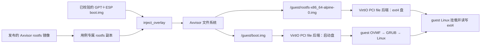

# Axvisor x86_64 UEFI 双盘验证设计

本文规划一条从现有 `dev` 实施的验证链路：把 GPT＋ESP 启动盘注入 Axvisor 自己的文件系统，由 VirtIO PCI `file` 后端提供给 x86_64 guest；同一 guest 再通过第二台 VirtIO PCI 设备访问已有的 ext4 镜像。阶段目标是证明两块盘在真实 OVMF 启动和 Linux 运行中协同工作。`tgosimages` 发布的 `rootfs-x86_64-alpine.img` 保持原样，验证运行时只修改其独立副本。

## 1. 目标与边界

这项验证针对当前无法让 `file` 后端打开 GPT 整盘镜像的问题。成功信号必须来自内层 Linux：OVMF 实际从注入的启动盘读取 ESP，GRUB 加载盘内 kernel 和 initramfs，Linux 识别启动盘的分区，并读取、挂载和写入第二块 ext4 盘。构建成功、固件横幅、看到两个 PCI endpoint 或由宿主向 guest 注入 shell 命令，均不单独构成通过。

### 1.1 完整运行链路

下面的图把外层 rootfs 文件、两台 guest 虚拟盘和真正执行启动程序的 guest OVMF 分开。`boot.img` 是外层 rootfs 中的普通文件，文件内容是整块 GPT 磁盘；`rootfs-x86_64-alpine-0.img` 是另一份无分区表的 ext4 镜像。



用例中的 Linux `/` 先保持为启动盘内的 initramfs；第二块 ext4 盘挂载在测试目录。把 ext4 盘切换成 Linux `/` 还涉及 initramfs 切根、发行版用户态和启动参数，不是证明双盘可用所必需的步骤。启动盘本轮配置为只读设备，但仍必须通过 `backend = "file"` 提供，不能借 `ramdisk` 预加载代替。启动盘可写、跨 QEMU 重启持久化、EFI 变量持久化、Secure Boot、SMP 和发布新 rootfs 属于后续阶段。

### 1.2 基线与复用

基线为 `feat/uefi-boot` 的 `ef80dc4e7`，与核查时上游 `dev` 一致。`uefiE2E` 的端点 `65a2892f8` 已提供单只读 ramdisk 启动盘的 OVMF 端到端路径，但其提交历史与 `dev` 分叉，不能整体合并。下表按行为决定哪些能力保留、移植或新增。

| 能力 | 当前 `dev` 证据 | 本方案动作 |
| --- | --- | --- |
| PCI VirtIO block 的异步文件 I/O | `axvm` 的 `configured/devices/virtio_blk/file.rs` 和 x86 `linux-virtio-blk.toml` 已使用 | 复用同一 `FileBackend` 与 PCI 设备图 |
| 协商后块请求限制、Q35 ECAM、传统 PIC 投递 | `#2510`、`#2501`、`#2518` 已进入 `dev` | 不移植 `uefiE2E` 中重叠修复 |
| 双 guest 的 ext4 文件后端 | `qemu/smoke/qemu-x86_64-{vmx,svm}.toml` 已挂载两个独立 ext4 镜像 | 复用现有数据盘路径和验证经验 |
| 磁盘 UEFI 启动来源 | `dev` 无 `VMBootSource::PciDisk`；`uefiE2E` 有该分流 | 按现有 `axvmconfig` 与 x86 boot 结构移植语义 |
| GPT＋ESP 文件后端 | `options.rs` 只接受 `filesystem = "ext4"`；`image.rs` 强制检查 ext4 超级块 | 增加整盘 raw 类型，不改变旧 ext4 默认行为 |
| 启动资产与注入 | `uefiE2E` 有已校验压缩盘、已知可用 OVMF 和测试期注入；`dev` 有 `inject_overlay()` | 使用临时资产，改在用例专属 rootfs 副本注入 |

当前已有的 `tmp-docs/x86-uefi-disk-e2e-test-design.md` 记录单盘只读 ramdisk 迁移方案；本文只借用其可验证的固件和启动资产，不继承 `image_path` ramdisk 作为本方案的启动设备实现。若基线继续变化，先重新比对上述五个代码边界及 CI 检查，再移植。

## 2. 运行时设计

两台设备都通过 `[[devices.virtual]] model = "virtio-blk"` 进入 AxVM 的设备图。Axvisor 不解析 guest 文件系统，也不把外层 NVMe 区域切给 guest；它分别打开两个文件，并在 guest 读写 VirtIO 扇区时访问相应文件偏移。UEFI 固件镜像仍由 `uefi_firmware_path` 单独提供，不能把外层 QEMU 的 OVMF 当作内层 guest 固件。

### 2.1 文件后端的镜像契约

`BackendConfig` 当前只有 `File { path, filesystem: Ext4 }`。实现应在 `configured/devices/virtio_blk/options.rs` 将文件布局归一为一个内部枚举：现有 `filesystem = "ext4"` 保持兼容；新增 `image_format = "raw"` 选择整盘字节映射，两字段同时出现时报配置错误。`image_format` 是磁盘文件的容器格式，不意味着 Axvisor 实现 GPT 或 FAT 文件系统。

`inspect_file_image()` 对两种格式共用“文件已存在、非空、长度为 512 字节整数倍、显式容量与文件长度完全一致”的检查。ext4 分支继续检查超级块和几何；raw 分支不按 ext4 偏移读取。GPT 主/备表、ESP 分区类型和 FAT 内容在资产准备阶段离线检查，再由真实 OVMF 和 Linux 执行链验证。文件后端保持原来的独占 worker、按需 I/O、flush、复位取消和 PCI DMA 授权路径，不另建同步 raw PCI 后端，也不把 256 MiB 启动盘预加载到内存。

验证用的 VM TOML 采用下列语义；实际字段名以实现后的配置解析器为准。`kernel_path` 暂保留供现有 `prepare_guest_boot()` 的非空校验和构建资产发现使用，`PciDisk` 路径不得把它发布为 `fw_cfg` kernel 或加载到 guest 内存作为启动来源。

```toml
[kernel]
boot_protocol = "uefi"
boot_source = "pci-disk"
uefi_firmware_path = "${workspace}/tmp/axbuild/axvisor/uefi-dual-disk/OVMF_CODE_4M.fd"

[[devices.virtual]]
id = "uefi-boot-disk"
model = "virtio-blk"
transport = "pci"
backend = "file"
path = "/guest/boot.img"
image_format = "raw"
read_only = true

[[devices.virtual]]
id = "linux-data-disk"
model = "virtio-blk"
transport = "pci"
backend = "file"
path = "/guest/rootfs-x86_64-alpine-0.img"
filesystem = "ext4"
read_only = false
```

### 2.2 固件启动来源

`axvmconfig::VMKernelConfig` 增加缺省为现有 kernel 路径的类型化 `VMBootSource`。`PciDisk` 只允许 x86_64、UEFI、`enable_bios = true` 且固件路径与加载地址有效的组合。`BootImagePlatform for X86_64Arch` 在该路径只把 OVMF 放入 guest 固件窗口，不装载配置中的占位 kernel/initramfs；`prepare_x86_firmware()` 仍依据已解析设备图提供 ACPI、`etc/table-loader` 等 `fw_cfg` 平台数据，但 kernel/initrd payload 为空。不得用空 ACPI 结构或跳过固件准备来实现“无 kernel”。

OVMF 通过唯一带 ESP 的 VirtIO PCI 启动盘找到 `EFI/BOOT/BOOTX64.EFI`，GRUB 从同一 ESP 读取 `/boot/vmlinuz` 与 `/boot/initramfs`。第二盘是整设备 ext4，Linux 挂载对应的 virtio 设备本体，不寻找它的 `p1` 分区。测试脚本不应仅靠 `/dev/vda`、`/dev/vdb` 的顺序证明身份：资产准备先核对 GPT 分区类型和 ESP 文件，guest 再读取启动盘 LBA1 的 `EFI PART` 标识及其分区节点，并用 GRUB 独有的内核参数证明实际来自该盘；第二盘通过 ext4 类型及 Alpine 内容识别。这样不预设盘内 initramfs 已带 VFAT 挂载驱动。实现前仍需确认该 initramfs 中用于原始扇区读取和 ext4 识别的 BusyBox applet 可用。

### 2.3 错误与资源边界

创建 VM 前应明确报告缺少启动盘文件、长度无效、容量不符、file 后端缺少 `fs`、错误的 `boot_source` 组合及缺失 OVMF 路径。两台盘都只由各自设备模型拥有文件句柄；读取、写入或 flush 失败沿现有 VirtIO 错误路径返回 guest。测试启动盘设置 `read_only = true`，即使底层文件句柄可写，VirtIO 层也必须拒绝 guest 写入；数据盘允许写入并由测试在同一运行中执行 `sync` 和回读。

外层 QEMU 测试采用丢弃写入策略；这不妨碍单次运行内的读写证明，但不能证明重启后落入 tgosimages 发布源或本地共享 rootfs。每次重试都重新创建用例副本并注入经校验的 boot 镜像。用例副本由准备阶段建立的临时目录句柄独占，正常结束及复制、注入、QEMU 配置补丁或启动任一步失败时均由该句柄清理；清理目标必须是明确的用例路径，不得指向共享 rootfs。

## 3. 资产与持续集成

本轮不修改 tgosimages 的发布物。启动资产以 `uefiE2E` 中已知可用的 GPT＋ESP gzip fixture、明文 `grub.cfg` 和 `/init` 为起点；改进 `/init` 的最终判定后重新生成压缩资产、记录压缩及 raw 摘要，并回读校验盘内文件。内层 OVMF 固定使用该分支记录的 CODE/VARS 配对，移植 `prepare_configured_x86_ovmf()` 的显式输入处理并复用当前 `assemble_ovmf_image()`，使构建配置精确指向已校验的固件文件。当前 `dev` 的 `test/initramfs.rs` 只从 Ostool 缓存准备 OVMF，不能直接复用该默认来源来声称 VirtIO 磁盘启动已受验证。将来若要改用 `cargo xtask ovmf --arch x86_64` 的固定版本，应单独证明其 VirtIO block 启动能力；本轮不扫描宿主 `/usr/share/OVMF`。

### 3.1 用例专属注入

`scripts/axbuild/src/axvisor/rootfs.rs::ensure_qemu_assets_ready()` 先准备外层 rootfs 和已有 guest 数据镜像。`test/case/assets.rs::prepare_case_assets()` 对 plain 用例返回共享 rootfs，并不会自动复制；因此 Axvisor QEMU 用例装配在得到该路径后，应为双盘用例创建临时目录，以 `copy_file_fast()` 复制外层镜像，再调用 `rootfs::inject::inject_overlay()` 把 `boot.img` 写成 `/guest/boot.img`。注入回读、同步成功后，用例装配把 QEMU 的 rootfs 路径指向临时副本，而不能继续指向原 `prepared_assets.rootfs_path`。临时目录句柄必须覆盖复制、注入、QEMU 补丁与运行全过程，或通过现有 `PreparedCaseAssets` 所有权与错误路径等价地保证清理；当前 `qemu_run.rs` 只清理已进入 runner 的用例，不能单独承担准备失败的回滚。复制和注入属于 `xtask` 用例准备，不可只写在 CI shell 中；本地与 CI 必须使用同一个入口。

输入准备采用确定的顺序：检查 gzip 摘要，解压到临时文件，检查 raw 摘要与长度，原子发布到用例暂存路径，然后注入专属外层 rootfs。输入必须是预期工作区内的普通文件，拒绝父目录穿越、符号链接、空文件、非扇区对齐和不符预期的容量；解压不得覆盖已验证的输入。每次运行都重建目标文件，不能仅因 `/guest/boot.img` 已存在而复用旧字节。启动失败时保留有效的失败阶段与首个错误，不让旧缓存或静默回退掩盖输入错误。`uefiE2E` 的测试专用 `prepare_configured_uefi_disk_image()` 可供比较，但其“注入共享 managed rootfs”的位置不直接沿用。

### 3.2 CI 入口

VMX 与 SVM 使用同一份 VM TOML、启动盘摘要、`/init` 和成功判定，分别加入 `.github/ci/checks/axvisor.toml` 中现有的 `kvm-intel`、`kvm-amd` Axvisor PCI block 检查。`cargo xtask axvisor test qemu --arch x86_64 --test-case <case>` 统一负责资产校验与解压、rootfs 副本、注入、构建、QEMU 启动和判定；CI shell 只调用该入口，使本地和 CI 走相同的资产准备流程。`check.suite.cases` 必须与实际发现的 VMX/SVM case 名称一致；不得放宽原有失败正则或改变 `.github/workflows/ci.yml` 自托管项的 `cache_key: ""` 约束。

资产暂放仓库用例目录，直到 tgosimages 提供正式启动盘。过渡资产的约 21 MiB gzip、256 MiB raw 和用例专属外层 rootfs 副本应记录 CI runner 实际磁盘峰值；若容量不足，先调整复制与清理位置，不用缩小判定或跳过 AMD/Intel 一侧。将来切换发布资产时，仅更换输入获取与摘要记录，保持 AxVM file backend、双盘 VM 配置和 guest 成功判定不变。

## 4. 验证与交付

最小证明由一个端到端行为用例在 VMX 与 SVM 两种宿主后端运行。`uefiE2E` 已验证 OVMF 从 ramdisk 启动；新断言必须能区分“误用 ramdisk”“只看到启动盘”“数据盘是 ext4 但不可读写”和“仍从 `fw_cfg` kernel 启动”。现有 PCI block、OVMF ACPI 与双 ext4 用例保留为各自的回归证据，不在新用例中重复枚举 BAR、INTx 和完整块请求协议。

### 4.1 可观察结果

盘内 `/init` 先检查只写在启动盘 GRUB 配置中的 case 参数，再读取启动盘 GPT 标识与其分区节点；GPT 中的 ESP 类型、FAT 内容及文件摘要由相同资产摘要的离线检查保证，不把“只有分区节点存在”当作 ESP 证明。然后它发现另一台内容为预期 Alpine ext4 的设备，将其以读写方式挂载到 `/mnt/data`。它应读出预期发行版文件，写入本次运行唯一的标记，执行 `sync`，卸载并重新挂载后回读该标记；全部成功才输出唯一一行 `AXVISOR_X86_UEFI_FILE_DUAL_DISK_PASSED`。任一失败输出 `AXVISOR_X86_UEFI_FILE_DUAL_DISK_FAILED`，且用例失败正则匹配该行。最终 marker 必须由内层 `/init` 发出，QEMU 用例先通过 `shell_check_steps` 的 `vm console 1` 接入 guest 控制台再匹配。

GRUB 配置应给 `/init` 独有的 case 参数；同时确保 `fw_cfg` 不含配置占位 kernel/initrd。测试准备阶段独立验证资产 GPT/ESP、`BOOTX64.EFI`、GRUB 配置、kernel 和 initramfs 的 digest，避免“进入 guest shell”掩盖错误启动来源。引入新 marker 前应确认旧 ramdisk 用例和只含单盘的变体不能满足新断言。

### 4.2 检查与风险收束

实现时先在 `axvm` 现有镜像检查测试中证明 raw 接受有效整盘文件、拒绝空文件、非扇区对齐和容量不符，并确认旧 ext4 拒绝 GPT 的行为没有被宽松默认取代。随后运行 `cargo fmt`、`cargo xtask clippy --package axvmconfig`、`--package axvm` 和 `--package axbuild`；这三个软件包都在 `scripts/test/std_crates.csv`，修改后还须运行 `cargo xtask test`。运行新的 VMX/SVM `cargo xtask axvisor test qemu`，只有真实自托管 KVM 用例命中内层 marker 才能宣称双盘启动通过；本地缺少对应硬件时明确记录未验证的后端与 CI 状态。

这项改动触及虚拟化启动和存储边界，代码合入前需要由熟悉 AxVM x86 固件与 VirtIO block 的领域审查人先审设计，再审实现。最终补丁需同步更新 `arch-platform-porting` 的 x86 guest UEFI 启动参考资料、VirtIO block 用户配置文档和用例 README。若验证失败，回退仅删除新 `boot_source` 配置及用例、raw 格式支持和注入编排；原有 ext4 file backend、默认 kernel 启动、OVMF ACPI 和 tgosimages 发布物保持可用。本文只规定验证方案，尚未声称运行结果。
