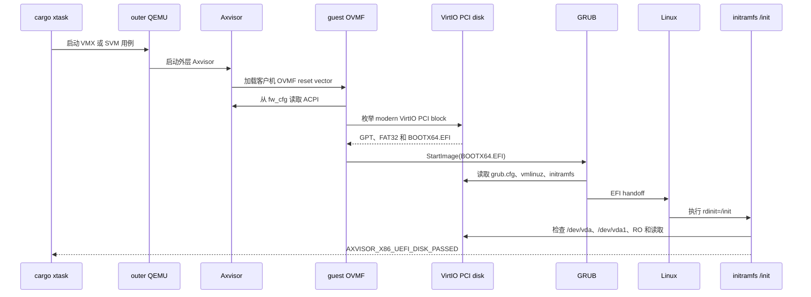

# Axvisor x86_64 UEFI 磁盘启动端到端测试设计

本文记录 Axvisor x86_64 客户机 UEFI 磁盘启动回归的设计和落地结果：外层 QEMU 启动 Axvisor，Axvisor 向客户机暴露只读 modern VirtIO PCI 块设备，客户机 OVMF 从该设备的 EFI System Partition 启动 GRUB 和 Linux，最终由磁盘内 initramfs 自行验证块设备并输出结果。实现以 `dev` 的现有分层为基础，以 `exp/uefi` 中已跑通的 `uefi-disk-vmx` 和 `uefi-disk-svm` 为行为证据，没有迁移排查期间产生的临时日志和诊断代码。

## 1. 测试目标

UEFI 磁盘测试补充现有 `ovmf-acpi-vmx/svm` 未覆盖的启动来源。现有 OVMF ACPI 用例通过 `fw_cfg` 直接提供 Linux kernel 和 initramfs，只能证明 OVMF、`fw_cfg` 和 ACPI 交接；本用例要求 OVMF 实际枚举 VirtIO PCI 块设备、读取 GPT/FAT32 ESP，并通过标准 fallback 路径启动磁盘内的 EFI 应用。

### 1.1 行为边界

测试从项目公开的 `cargo xtask axvisor test qemu` 入口开始，贯穿外层 QEMU、Axvisor 设备图、客户机 OVMF、VirtIO PCI block、GRUB、Linux 和 initramfs。最终 marker 必须来自内层 Linux 客户机，不能由外层 Axvisor、测试准备脚本或宿主机伪造。

测试保护的完整行为是：当 x86_64 virtualized guest 配置 `boot_protocol = "uefi"`、`boot_source = "pci-disk"` 和一块 image-backed 只读 VirtIO PCI ramdisk 时，客户机必须从该磁盘进入 Linux，Linux 必须识别同一块磁盘为可读的只读 `/dev/vda`，并输出 `AXVISOR_X86_UEFI_DISK_PASSED`。

### 1.2 成功标准

成功条件只保留能够区分正确启动链和错误实现的终态证据。固件横幅、PCI 配置读取、queue notify、单次后端读取和进入 BusyBox shell 都只是中间检查点，不单独构成通过条件。

1. OVMF 从 VirtIO PCI block 的 ESP 启动 `EFI/BOOT/BOOTX64.EFI`。
2. GRUB 从同一 ESP 加载 `/boot/vmlinuz` 和 `/boot/initramfs`。
3. Linux 执行 initramfs 中的 `/init`，表明固件、EFI 应用、kernel 和 initramfs 交接均已完成。
4. `/dev/vda` 和 `/dev/vda1` 均为块设备，表明 Linux `virtio_pci`、`virtio_blk` 和 GPT 分区扫描已完成。
5. `/sys/class/block/vda/ro` 为 `1`，且读取 `/dev/vda` 首扇区成功。
6. 客户机输出独立一行 `AXVISOR_X86_UEFI_DISK_PASSED`；任一检查失败时输出独立一行 `AXVISOR_X86_UEFI_DISK_FAILED`。
7. Intel/VMX 和 AMD/SVM 使用同一客户机 TOML、同一启动盘 digest 和同一客户机判定逻辑分别通过。

### 1.3 非目标

本用例只证明单 vCPU 客户机从只读 VirtIO PCI 磁盘完成 UEFI 启动，不借测试迁移扩大产品范围。

- 不验证可写 EFI variable store、Secure Boot 或跨 reset 的变量持久化。
- 不验证多 vCPU INIT-SIPI、MSI/MSI-X、VirtIO packed ring 或多 queue。
- 不重复现有 PCI block RW/RO 用例中的完整配置空间、BAR、capability、写拒绝和 INTx 计数断言。
- 不把排查中发现的 PPR、PIC、pending-event、ordered-output 等独立正确性问题捆绑进测试迁移。
- 不把手工 `.img.gz` 定义为长期资产发布方式；它只是在 tgosimage 提供正式镜像前的过渡输入。

## 2. 实施基线

实施前的 `dev` 已有 x86 OVMF ACPI 和 VirtIO PCI block 数据盘测试，但没有 `boot_source = "pci-disk"`、image-backed ramdisk 预加载以及对应的 UEFI 启动盘准备流程。实现没有整体 cherry-pick 分叉较早的 `exp/uefi`，而是按当前分层重建这些能力。

### 2.1 现有代码入口

迁移应适配当前代码分层，而不是恢复实验分支中的旧单文件实现。下表列出实现时需要保持的主要代码锚点及其功能意义。

| 代码对象 | 当前职责 | 本设计要求 |
| --- | --- | --- |
| `VMKernelConfig`、`VMBootProtocol` | 保存客户机 kernel 和固件启动配置 | 增加类型化 `VMBootSource`，校验 PCI disk 只用于 x86_64 UEFI |
| `BootImagePlatform for X86_64Arch` | 选择 direct、multiboot 或 UEFI 加载路径 | PCI disk 路径加载 OVMF，但不加载配置中的占位 kernel/initrd，也不向 `fw_cfg` 发布它们 |
| `prepare_x86_firmware()` | 从 resolved device graph 生成 direct ACPI 和 `fw_cfg` ACPI | PCI disk 仍调用 `build_fw_cfg_blobs()`，不得使用空 `FwCfgAcpiBlobs` |
| `BackendConfig` | 解析 VirtIO block 的 file 或零填充 ramdisk backend | ramdisk 接受可选 `image_path`，从 Axvisor rootfs 预加载 raw disk |
| `RamDiskBackend` | 保存同步内存块设备内容 | 从镜像字节初始化容量，并继续由 device-level `read_only` 强制只读 |
| `ensure_qemu_assets_ready()` | 拉取客户机 kernel bundle并准备外层 rootfs | 必须先完成 rootfs 准备，随后才能注入 UEFI disk |
| `prepare_x86_ovmf()`、`assemble_ovmf_image()` | 拉取 pinned OVMF，并把 split 或 monolithic 输入组装成 4 MiB 固件 | 保留默认下载行为；只有 UEFI disk build 通过显式 env 选择仓库内已知可用的 CODE/VARS |
| `prepare_configured_busybox_initramfs()` | 按 build env 生成 direct/fw_cfg 客户机 initramfs | 不负责修改静态 UEFI disk；UEFI disk build 不设置该无效输出变量 |

`scripts/axbuild/src/axvisor/test/qemu.rs` 已把准备阶段拆成 `prepare_configured_busybox_initramfs()`、`prepare_configured_x86_ovmf()` 和 `prepare_configured_uefi_disk_image()` 三个调用：都位于 rootfs 可用之后、Axvisor build 之前，各自只处理一种资产。CI 负责临时 gzip 解压，gzip 与 disk overlay 没有塞入 `initramfs.rs`。

### 2.2 手工启动盘

当前 `exp/uefi` 中的 `uefi-guest.img.gz` 是一次手工组装并提交的测试 fixture。迁移初期继续使用它的修改版，避免在 tgosimage 尚无对应资产时阻塞端到端回归。

| 属性 | 当前值 |
| --- | --- |
| gzip SHA-256 | `423de35a090ae2991b3866f35261f4802e61b212299ce5e5a3aee77c38409d85` |
| raw image SHA-256 | `b4b41c429af81b2d3dea7214df500467eee6629ae242eedb1ac4e1b222b10f1d` |
| raw image 大小 | 256 MiB，`268435456` 字节 |
| 分区表 | GPT，单个 EFI System Partition |
| ESP | FAT32，LBA `2048..522239`，label `EFI`，UUID `EACD-AFF8` |
| EFI fallback | `EFI/BOOT/BOOTX64.EFI`，GRUB `2.06-2ubuntu14.8` |
| Linux | `/boot/vmlinuz`，与现有 tgosimage `qemu-x86_64/linux/linux-qemu` 字节一致 |
| initramfs | `/boot/initramfs`，SHA-256 `ed4a2fce14115adfb90744def85e37583b5f3289dbf4edcc0f623b0ee802b239`，内置 UEFI disk 判定 |

提交资产由原 raw image 派生，只修改 `/boot/initramfs` 和 `/boot/grub/grub.cfg`。GPT、ESP、GRUB 和 Linux kernel 保持不变，表中 digest 与仓库 checksum 文件一致。

### 2.3 现有 initramfs 的局限

磁盘中的旧 `/init` 来自 Axvisor 通用 initramfs 模板，支持 ACPI 和 timer case，却没有 UEFI disk case。它读取 `/proc/cmdline` 后落入 `AXVISOR_GUEST_ASSERTION_CASE_UNKNOWN` 分支并启动交互 shell，所以实验测试只能匹配 BusyBox 的 shell 提示输出，再从宿主向客户机注入 `/dev/vda` 检查命令。

`AXVISOR_TEST_BUSYBOX_INITRAMFS` 在 `exp/uefi` build TOML 中会让 `axbuild` 生成一份新的 cpio.gz，但客户机配置没有引用该路径，测试准备也没有把它写入 `uefi-guest.img`。因此这份运行时生成物不参与实际启动，不能作为磁盘内 initramfs 的来源或更新机制。

### 2.4 方案取舍

实现采用“仓库提交临时 gzip fixture，CI 解压 raw image，axbuild 只消费 raw image”的边界。以下备选方案不再留给实现阶段决定。

| 方案 | 结论 | 原因 |
| --- | --- | --- |
| 等待 tgosimage 正式资产 | 暂不采用 | 会继续阻塞已经可验证的 UEFI 启动回归 |
| 由 `axbuild` 自动识别并解压 gzip | 不采用 | 临时发布格式会进入长期 Rust 接口，后续切换 tgosimage 还需删除产品无关逻辑 |
| CI 在调用测试前解压 | 采用 | 临时性集中在 CI 和 README；`axbuild` 始终只接收最终 `.img` |
| 每次测试运行时修改 FAT/initramfs | 不采用 | 会引入 `mtools`、`cpio` 等 runner 依赖，并使实际启动字节不再由提交 digest 唯一确定 |
| 提交修改后的静态 fixture | 采用 | 测试运行只做校验和复制，资产内容可由明文 `/init`、GRUB 配置和 digest 审查 |

## 3. 启动链路

这条链路包含两层机器和两个不同的固件边界。外层 OVMF 只负责启动 Axvisor；内层 OVMF 位于客户机物理内存中，并通过 Axvisor 模拟的 `fw_cfg` 和 VirtIO PCI block 完成平台发现与磁盘启动。

### 3.1 交互顺序

下图给出测试必须实际经过的顺序，以及最终 marker 的唯一合法来源。测试运行器只观察串口输出，不参与内层 shell 操作。



到达 `/init` 已经证明 OVMF、VirtIO firmware driver、ESP、GRUB 和 Linux kernel 交接成功；`/init` 的块设备检查再证明 Linux 运行时驱动识别了同一设备。二者组合构成端到端信号，不需要保留 queue、LBA、PE entry 或 VM-exit 诊断日志。

### 3.2 固件数据边界

PCI disk 启动改变的是 kernel 来源，不改变 OVMF 获取平台 ACPI 的方式。`x86_fw_cfg_payload()` 在 `VMBootSource::PciDisk` 下返回空 kernel/initrd payload，但 `prepare_x86_firmware()` 仍根据 `X86FirmwarePlan` 生成并发布 `etc/acpi/tables`、`etc/acpi/rsdp` 和 `etc/table-loader`。

配置中的 `kernel_path` 在现有 `VMKernelConfig` 形状下可以暂时保留为 managed `linux-qemu` 路径，但 loader 不得读取或加载它。后续若公共配置允许 PCI disk source 省略 kernel，再单独收敛这个兼容字段，不在测试迁移中扩大接口变化。

### 3.3 VirtIO 磁盘边界

客户机配置通过 `transport = "pci"`、`backend = "ramdisk"` 和 `image_path` 表达“从 Axvisor 文件系统读取一次 raw image，再以内存快照提供给客户机”。`image_path` 是外层 Axvisor rootfs 内的路径，不是执行 `cargo xtask` 的宿主路径。

```toml
[[devices.virtual]]
id = "uefi-boot-disk"
model = "virtio-blk"
transport = "pci"
backend = "ramdisk"
image_path = "/uefi/uefi-guest.img"
read_only = true
```

`BackendConfig::RamDisk` 扩展为携带可选 `image_path`；未配置时保持当前 2 MiB 或显式 `capacity` 的零填充行为。配置 `image_path` 时，字段必须是非空字符串，且 `path`、`filesystem` 仍按 file backend 专属字段拒绝。读取镜像需要 `fs` feature；缺少该 feature 时返回配置错误，不得退回零填充盘。

image-backed ramdisk 必须拒绝空文件、非 512 字节对齐镜像、短读和无法分配的长度。未配置 `capacity`/`capacity_sectors` 时，容量等于镜像长度；显式容量必须与镜像长度完全相等，较大或较小都作为配置错误。这与当前 file-backed image 的容量契约一致，也避免静默截断或补零。`read_only = true` 是设备端强制策略，不能只依赖 guest 是否协商 `VIRTIO_BLK_F_RO`。

### 3.4 启动配置兼容性

`VMBootSource` 是 `VMKernelConfig` 的类型化字段，serde 名称为 `kernel` 和 `pci-disk`，缺省值为 `Kernel`。因此所有旧配置的 effective state 不变；未知字符串由反序列化直接拒绝。

`PciDisk` 只在 `x86_64 + enable_bios = true + boot_protocol = uefi` 时有效，并继续要求可解析的 firmware path 和 load address。与 direct、multiboot、非 x86 架构组合时应返回带字段上下文的配置错误。现阶段 `kernel_path` 仍是结构上的必填字段，但 PCI disk loader 不读取它；这项兼容妥协应在字段注释和测试 TOML 中说明，不能通过放宽所有启动方式的 kernel 要求来解决。

## 4. 测试资产

过渡期资产方案优先保证测试可运行、可审查和不依赖运行器残留状态。仓库提交压缩 fixture，CI 在调用测试前把它解压到工作区临时目录，`axbuild` 只校验并把现成的 raw image 注入外层 Axvisor rootfs；测试不读取或写入宿主 `/tmp/uefi-guest.img`。gzip 是临时资产的包装格式，不进入长期 `axbuild` 接口。

### 4.1 目录结构

稳定用例从 `experimental` 移入 `normal`，资产及其可审查输入放在同一 build wrapper 下。

```text
test-suit/axvisor/normal/qemu-uefi-disk/
├── README.md
├── build-x86_64-unknown-none-vmx.toml
├── build-x86_64-unknown-none-svm.toml
├── x86-linux-uefi-disk.toml
├── assets/
│   ├── OVMF_CODE_4M.fd
│   ├── OVMF_VARS_4M.fd
│   ├── uefi-guest.img.gz
│   ├── uefi-guest.img.gz.sha256
│   ├── uefi-guest.img.sha256
│   ├── init
│   ├── grub.cfg
│   └── update-image.sh
└── uefi-disk/
    ├── qemu-x86_64-vmx.toml
    └── qemu-x86_64-svm.toml
```

`assets/init` 和 `assets/grub.cfg` 是嵌入二进制 fixture 的明文依据，使 reviewer 能直接核对判定逻辑。它们不是运行时覆盖层；提交 `.img.gz` 前必须确认磁盘内文件与这两个明文输入一致。两个 checksum 文件分别采用标准 `sha256sum` 格式记录压缩文件和解压后同名 raw image，避免把 digest 散落在 CI 命令中。`.gitattributes` 把 `*.fd` 和 `*.img.gz` 标为 binary，避免 diff 或行尾转换误处理。

### 4.2 内置判定

新的 `/init` 使用 kernel cmdline `axvisor.uefi_disk_case=ro` 选择 UEFI disk 检查。检查只覆盖本用例独有的最终行为，不复制普通 PCI block 用例的完整协议测试。

```sh
run_x86_uefi_disk_check() {
  failed=0

  [ -b /dev/vda ] || failed=1
  [ -b /dev/vda1 ] || failed=1
  [ "$(/bin/busybox cat /sys/class/block/vda/ro 2>/dev/null)" = "1" ] || failed=1
  /bin/busybox dd if=/dev/vda of=/dev/null bs=512 count=1 2>/dev/null || failed=1

  if [ "$failed" -eq 0 ]; then
    echo AXVISOR_X86_UEFI_DISK_PASSED
  else
    echo AXVISOR_X86_UEFI_DISK_FAILED
  fi
}
```

实际 `assets/init` 应为每个失败条件输出一条短而明确的原因，随后再输出统一 FAILED marker。成功 marker 输出后可以进入 BusyBox shell，方便人工运行时继续检查；自动测试在匹配 marker 后结束，不依赖 shell 是否出现。

磁盘内 `/boot/grub/grub.cfg` 增加 case 参数，并移除仅用于排查的 verbose kernel 参数。

```grub
set timeout=0
set default=0

menuentry "Linux from virtio disk" {
    linux /boot/vmlinuz console=ttyS0 rdinit=/init axvisor.uefi_disk_case=ro
    initrd /boot/initramfs
}
```

`console=ttyS0` 和 `rdinit=/init` 属于长期启动契约；`loglevel=7`、`ignore_loglevel` 和 `initcall_debug` 不进入稳定资产。

### 4.3 CI 解压与运行时注入

自动化路径中的 gzip 解压只出现在 `.github/ci/checks/axvisor.toml` 的临时用例准备命令中，不由 `axbuild` 实现。本地 README 提供同一段手工准备命令。输出固定放在 workspace 的 `tmp/axbuild/axvisor/qemu-uefi-disk/uefi-guest.img`，避免不同用户和并行任务共享宿主 `/tmp` 路径。

```bash
set -euo pipefail
uefi_asset_dir=test-suit/axvisor/normal/qemu-uefi-disk/assets
uefi_raw_dir=tmp/axbuild/axvisor/qemu-uefi-disk
uefi_raw_tmp=${uefi_raw_dir}/uefi-guest.img.tmp
uefi_raw_image=${uefi_raw_dir}/uefi-guest.img

(cd "${uefi_asset_dir}" && sha256sum --check uefi-guest.img.gz.sha256)
mkdir -p "${uefi_raw_dir}"
gzip -dc "${uefi_asset_dir}/uefi-guest.img.gz" > "${uefi_raw_tmp}"
uefi_raw_sha=$(awk '{print $1}' "${uefi_asset_dir}/uefi-guest.img.sha256")
printf '%s  %s\n' "${uefi_raw_sha}" "${uefi_raw_tmp}" | sha256sum --check -
mv "${uefi_raw_tmp}" "${uefi_raw_image}"
```

CI 先用 `uefi-guest.img.gz.sha256` 校验仓库输入，再解压并用 `uefi-guest.img.sha256` 校验临时 raw 文件，最后才执行原子 `mv` 和 `cargo xtask axvisor test qemu`。先验证压缩输入可以防止被意外替换的压缩包产生无界输出，先写临时文件则防止中断或 gzip 校验失败后留下一个被后续步骤误用的部分镜像。Axvisor CI 命令使用失败即终止的 shell，任何输入 digest、解压、raw digest 或移动错误都必须阻止 QEMU 启动；已有最终文件也不能让失败步骤继续运行。

`scripts/axbuild/src/axvisor/test/uefi_disk.rs` 中的 `prepare_configured_uefi_disk_image()` 读取 build env 中的 `AXVISOR_TEST_X86_UEFI_DISK_IMAGE`。该值指向已经存在的 workspace-relative raw image；函数拒绝父目录穿越，校验输入是普通文件、长度恰为 `268435456` 字节且为 512 的整数倍，然后通过现有 rootfs overlay 覆盖 `/uefi/uefi-guest.img`。它不识别 gzip、不负责下载资产，也不在正常路径打印 digest、LBA 或复制进度。

该注入发生在 `ensure_qemu_assets_ready()` 之后、Axvisor 构建之前。它会修改 workspace 下测试专用的 managed rootfs，但每次 UEFI build 都必须从已校验的 host raw image 覆盖目标文件，不能因为 guest 路径已经存在而跳过。VMX/SVM 使用相同输入且 build group 顺序执行，因此共享该只读内容是确定的。注入失败时停止构建和 QEMU；恢复时只删除准确的 managed rootfs 文件并重新拉取，不删除整个 `tmp/axbuild`。长期若测试开始并行修改不同 UEFI 盘，再改为 per-case rootfs copy，本次迁移不预先引入该复杂度。

本地开发者在运行 VMX/SVM 用例前执行与 CI 相同的解压和 digest 校验命令。测试 README 必须记录这个前置步骤；缺少 raw image 时 `axbuild` 明确失败，不能自动读取宿主 `/tmp`、隐式解压或沿用其他用例生成物。

### 4.4 资产更新

过渡资产允许从当前 fixture 派生，但更新过程必须可重复。`assets/update-image.sh` 是仅供维护者离线运行的工具，不进入 CI：它先核对旧 checksum 并解压 raw image，使用固定 ESP offset `2048 * 512 = 1048576` 和 `mtools` 替换 FAT32 中的 `/boot/initramfs`、`/boot/grub/grub.cfg`，再重新读出文件核对。initramfs 从旧 archive 解包，替换顶层 `/init` 后以 `newc`、root ownership、归零时间戳、稳定路径排序和 `gzip -n` 重建；磁盘整体也用 `gzip -n` 压缩。脚本启动时检查 `gzip`、GNU `cpio`、`mcopy`、`mtype`、`sha256sum` 和 `fdisk`，缺少工具就失败，不能降级为 loop mount 或修改宿主全局状态。

脚本只修改临时 raw 副本，全部内容回读和结构检查成功后才原子替换 `uefi-guest.img.gz` 及两个 checksum 文件。这样脚本失败不会损坏已提交 fixture，也不会要求 CI 安装 FAT/cpio 写入工具。README 记录脚本依赖和调用方式，并明确普通测试参与者只需要执行第 4.3 节的 gzip 解压。

资产更新记录至少包含：

- 修改前和修改后的 gzip/raw SHA-256；
- 磁盘内 `/boot/vmlinuz` SHA-256，确认 kernel 未被意外替换；
- 磁盘内 `/boot/initramfs` SHA-256；
- `EFI/BOOT/BOOTX64.EFI` SHA-256，确认 GRUB 未被意外替换；
- `fdisk -l` 或等价解析得到的 GPT/ESP 起止扇区；
- 直接 QEMU + OVMF 基线，以及 Axvisor VMX/SVM 两个最终 marker。

这份记录属于资产 provenance，不应转化为每次测试运行都打印的大量证据日志。

第 2.2 节已记录修改后的 gzip/raw digest。已知 OVMF 输入保持如下，更新任一文件都视为独立固件升级：CODE 大小 `3653632`、SHA-256 `4be36bffc62a85538e5c2df2882da63c21a7f5683a5b439701d0823e26dcaee3`；VARS 大小 `540672`、SHA-256 `5d2ac383371b408398accee7ec27c8c09ea5b74a0de0ceea6513388b15be5d1e`；两者拼接后必须恰为 4 MiB。

### 4.5 tgosimage 迁移

tgosimage 提供正式 UEFI disk 后，测试应只替换 CI 资产准备步骤，不改变客户机配置、启动链或结果 marker。理想资产由固定配方从 `linux-qemu`、专用 initramfs 和最小 GRUB EFI 文件生成，并发布 raw image digest。

切换时删除仓库内 `uefi-guest.img.gz` 和 CI 中的 gzip 命令，改为通过现有 image storage 拉取 bundle。bundle 解包后的 `.img` 路径继续传给 `AXVISOR_TEST_X86_UEFI_DISK_IMAGE`，并由同一个 raw image 注入函数写入 `/uefi/uefi-guest.img`；由于 `axbuild` 从未获得 gzip 接口，切换时无需清理 Rust 压缩处理代码，`x86-linux-uefi-disk.toml` 也无需改变。

## 5. 用例配置

VMX 与 SVM 用例共享客户机和测试资产，只在外层 QEMU CPU 参数和 CI runner 上区分后端。Cargo build config 不选择 `vmx` 或 `svm` feature；两个 build TOML 即使因当前发现机制需要分别存在，其内容也必须保持后端中立。

### 5.1 客户机配置

`x86-linux-uefi-disk.toml` 使用单 vCPU virtualized guest、4 MiB OVMF firmware window 和一块只读 VirtIO PCI block。关键配置如下。

| 字段 | 值 | 行为 |
| --- | --- | --- |
| `guest_type` | `virtualized` | 走客户机可见 vIOAPIC、vLAPIC 和虚拟设备路径 |
| `cpu_num` | `1` | 隔离 UEFI 磁盘启动风险，不引入 INIT-SIPI |
| `boot_protocol` | `uefi` | 选择 OVMF 固件 |
| `boot_source` | `pci-disk` | 禁止从配置 kernel 或 `fw_cfg` kernel payload 启动 |
| `uefi_firmware_path` | axbuild 生成的 4 MiB firmware | 加载已知可用的 OVMF CODE/VARS 组合 |
| `bios_load_addr` | `0xffc0_0000` | 对应顶部 4 MiB firmware 映射 |
| `image_path` | `/uefi/uefi-guest.img` | 从外层 Axvisor rootfs 预加载 raw disk |
| `read_only` | `true` | device 和 Linux 均观察只读策略 |

配置仍保留 low 512 MiB RAM 和顶部 4 MiB firmware region。PCI、IOAPIC、fw_cfg 和 ACPI 资源由当前 resolved device graph 规划，测试 TOML 不硬编码 BAR 或 GSI。

两个 build TOML 都设置 `features = ["fs"]` 并使用同一组准备接口，避免 VMX/SVM 资产漂移。`fs` 是 Axvisor 从外层 rootfs 读取固件和磁盘镜像所必需的能力，不是为了测试脚本临时开启的无关 feature。

| build env | 必需性 | 契约 |
| --- | --- | --- |
| `AXVISOR_TEST_X86_OVMF_OUTPUT` | 必需 | workspace-relative 4 MiB 组装输出，供 `uefi_firmware_path` 引用 |
| `AXVISOR_TEST_X86_OVMF_INPUT` | 必需 | 仓库内 `OVMF_CODE_4M.fd`；设置它必须同时设置 output |
| `AXVISOR_TEST_X86_OVMF_VARS_INPUT` | 必需 | 仓库内 `OVMF_VARS_4M.fd`；设置它必须同时设置 CODE input |
| `AXVISOR_TEST_X86_UEFI_DISK_IMAGE` | 必需 | CI 已解压并校验的 workspace-relative raw `.img` |
| `AXVISOR_TEST_BUSYBOX_INITRAMFS` | 禁止 | 生成物不会进入静态启动盘，设置它会制造无效工作和误导性日志 |

`ovmf.rs` 增加 `prepare_configured_x86_ovmf()` 以及从显式 monolithic 或 split host path 组装的入口，并复用现有 `assemble_ovmf_image()`、原子安装和低层测试；`initramfs.rs` 中现有 OVMF env 分支随之迁移，不保留两套编排。显式 input/output 都只接受无父目录穿越的 workspace-relative path。未设置显式 input 的现有 OVMF ACPI 用例仍走 pinned 下载，保持兼容；UEFI disk 不扫描 `/usr/share/OVMF`，也不在输入无效时静默回退到 pinned 固件。运行日志只保留现有单次固件准备摘要、case 起止和最终 guest marker，不迁移实验分支的寄存器、LBA、queue、VM-exit 或周期性状态日志。

### 5.2 外层 QEMU

稳定 QEMU 配置沿用现有 Axvisor x86 KVM 用例的最小参数。VMX 使用 `host,-la57,+vmx-ept,+vmx-unrestricted-guest,+vmx-flexpriority`，SVM 使用 `host,-la57,+svm,+npt,+nrip-save`；两者都使用 `q35`、`-smp 2` 和 KVM。

以下实验参数必须删除：

- `-d cpu_reset,guest_errors`；
- `-D /tmp/axvisor-uefi-*-qemu-debug.log`；
- `-no-reboot`；
- 1800 秒诊断超时；
- 匹配 BusyBox prompt 并向 guest shell 注入检查命令的步骤。

稳定用例使用与同类 Axvisor 测试一致的 600 秒 timeout。唯一保留的 shell step 匹配 Axvisor prompt 并执行 `vm console 1`，不向客户机 shell 写入命令。`success_regex` 只匹配独立的 PASSED marker；`fail_regex` 至少包含独立 FAILED marker、`AXVISOR_GUEST_ASSERTION_CASE_UNKNOWN`、kernel panic、page fault、VM exit failure 和 guest VM 初始化失败。UNKNOWN 必须 fail-fast，防止磁盘意外沿用旧 initramfs 时退回 shell 并等满 timeout。

### 5.3 CI 接入

CI 分别在 `kvm-intel` 和 `kvm-amd` runner 上运行 `uefi-disk-vmx` 和 `uefi-disk-svm`。两个 check 在测试命令前各自校验并解压同一份 `uefi-guest.img.gz`，不依赖 runner 缓存或另一个 check 的输出。

实现把 VMX case 追加到 `test-axvisor-x86-64-pci-block-vmx`，把 SVM case 追加到 `test-axvisor-x86-64-pci-block-svm`，并同步更新名称和 `check.suite.cases`。这两个 check 已具备对应 runner、x86 image pull 和 VirtIO PCI block 归因，单独新建 check 只会重复构建。每个 check 只在 UEFI case 前准备一次 raw image，RW/RO 数据盘 case 不依赖它；check 的 `timeout_minutes` 从 45 提高到 60，为新增用例预留总任务时间，但单个 QEMU case 仍保持 600 秒 timeout，避免掩盖挂起。

`.github/ci/checks/axvisor.toml` 中的 `check.suite.cases` 必须包含新 case，使任务影响分析、命令和声明的证据一致。自托管矩阵项继续保持 `cache_key: ""`。

## 6. 实现分解

迁移按能力、资产和门禁拆分，避免把实验分支中大量诊断提交压成一个无法审查的改动。每一步都基于当前 `dev` 重写，不能以 cherry-pick 成功代替语义核对。

### 6.1 产品能力

第一组改动补齐测试真正依赖的公共能力。

1. 在 `axvmconfig` 增加 `VMBootSource::{Kernel, PciDisk}`、serde 名称、默认值和 x86 UEFI 校验。
2. 在 x86 boot loader 中让 PCI disk 路径只准备固件和 `fw_cfg` ACPI，不加载或发布配置 kernel/initrd。
3. 在当前拆分后的 VirtIO block `options.rs` 和 `device.rs` 中支持 ramdisk `image_path`，把它加入 known-options 集合，并验证字段冲突、容量相等、对齐、短读和 `fs` feature。
4. 为上述规则补最少的配置、loader payload 和 backend 行为测试，不复制完整 QEMU 断言。

其中 ACPI 行为必须以当前 `dev` 无条件调用 `build_fw_cfg_blobs()` 的实现为基线，不能恢复 `2fee52573` 曾引入的空 ACPI blobs 分支。

### 6.2 测试资产与用例

第二组改动只建立端到端 fixture 和运行编排。

1. 从现有 `uefi-guest.img.gz` 生成修改版，嵌入专用 `/init` 和更新后的 GRUB cmdline。
2. 提交 `assets/init`、`assets/grub.cfg`、新 gzip/raw digest 和资产更新证据。
3. 在 CI 命令中增加临时 gzip 解压和 raw digest 校验。
4. 把用例放入 `test-suit/axvisor/normal/qemu-uefi-disk`。
5. 扩展 `ovmf.rs` 和准备编排，使该 build 显式使用仓库内 CODE/VARS，同时保持其他用例的 pinned OVMF 默认路径。
6. 增加 `uefi_disk.rs` 的 raw image校验和 rootfs 注入逻辑，不在其中实现 gzip。
7. 删除无效的 `AXVISOR_TEST_BUSYBOX_INITRAMFS`、shell 注入、QEMU debug 参数和过期实验说明。

`OVMF_CODE_4M.fd` 和 `OVMF_VARS_4M.fd` 暂时保留为测试已知可用固件，因为当前 pinned ostool OVMF 不包含可用于该场景的 VirtIO block UEFI driver。固件来源升级应单独处理，不能在本迁移中改成扫描宿主 `/usr/share/OVMF`。

### 6.3 独立问题处理

迁移首先在没有实验诊断代码的 `dev` 上运行最小链路。若 VMX 或 SVM 失败，再以最早确定错误为依据单独修复当前仍成立的产品问题；不能为了让用例通过而一次性搬运 `exp/uefi` 上所有中断和输出改动。

下列提交内容明确不进入迁移：`debug(uefi)`、`debug(axvisor)`、emergency UART 诊断 wrapper、PE/LBA/queue 采样、`049c7f328` 的 CI 裁剪、`d88c96026` 的长超时以及 `tmp-docs/uefi-disk-diagnosis.md`。如果某个 correctness bug 被新用例稳定复现，它应带独立 fail-first 证据进入后续提交。

### 6.4 文件级落点

实施者可以按下表建立变更清单；未列出的实验分支文件默认不迁移。

| 文件或目录 | 预期改动 |
| --- | --- |
| `virtualization/axvmconfig/src/lib.rs` 及测试 | 定义、默认化并校验 `VMBootSource` |
| `virtualization/axvm/src/arch/x86_64/boot/mod.rs` | 分流 PCI disk 的 firmware、ACPI 和 kernel payload/load 行为 |
| `virtualization/axvm/src/configured/devices/virtio_blk/{options,device}.rs` | 解析 `image_path`，读取 raw image并构造 ramdisk |
| `scripts/axbuild/src/axvisor/test/{qemu,initramfs,ovmf,uefi_disk}.rs` 和 `mod.rs` | 拆分三类准备入口，校验 OVMF/raw input，注入 disk overlay |
| `test-suit/axvisor/normal/qemu-uefi-disk/**` | build、guest、QEMU 配置，已知固件，启动盘，明文输入和维护说明 |
| `.github/ci/checks/axvisor.toml` | 在现有 VMX/SVM PCI block check 中解压资产并追加 case |
| `.gitattributes` | 把本用例的 `.fd`、`.img.gz` 标记为 binary |
| `.agents/skills/arch-platform-porting/references/boot-debugging.md` | 记录 PCI disk UEFI source、fw_cfg ACPI 和镜像准备契约 |

## 7. 验证策略

验证分为资产结构、低层行为和真实 KVM 端到端三层。低层测试负责快速定位配置与镜像后端错误，VMX/SVM 用例负责证明低层替身无法覆盖的 OVMF、VirtIO、GRUB、Linux 和中断时序。

### 7.1 失败优先证明

实现内置判定前，先用旧 asset 运行迁移后的无 shell-injection 用例，预期因没有 `AXVISOR_X86_UEFI_DISK_PASSED` 而失败。替换磁盘内 initramfs 和 GRUB cmdline 后，同一 QEMU 配置应命中 marker；这证明通过来自 fixture 行为变化，而不是放宽 matcher。

产品能力的回归分别使用能够破坏结果的旧实现核对：删除 `PciDisk` loader 分流应导致 kernel 来源错误，恢复零填充 ramdisk 应使 OVMF 找不到有效 GPT/ESP，恢复空 `FwCfgAcpiBlobs` 应使客户机 ACPI 失败。只检查配置字段回读或 helper 被调用不构成失败证明。

### 7.2 静态与组件验证

修改 Rust 后先执行格式化和项目封装的定向静态检查。测试资产还需要用宿主工具做只读结构核验。

```bash
cargo fmt
cargo xtask clippy --package axvmconfig
cargo xtask clippy --package axvm
cargo xtask clippy --package axbuild
cargo xtask test --since <base-ref>
cargo xtask axvisor test qemu --list --arch x86_64
```

`axvmconfig`、`axvm` 和 `axbuild` 均在 `scripts/test/std_crates.csv` 中，因此修改其 Rust 单元测试后通过项目统一的 `cargo xtask test --since <base-ref>` 运行，不使用原生 `cargo test`。若增量选择未覆盖预期软件包，应以 `cargo xtask test` 全量入口复核。

资产核验应确认 raw image 大小和 digest、GPT/ESP 布局、`BOOTX64.EFI`、GRUB 配置、kernel、initramfs，以及 initramfs 内 `/init` 的 marker 分支。只验证 gzip 可解压或 FAT 可列目录不足以证明启动资产正确。

### 7.3 端到端验证

最终门禁必须分别在匹配硬件的 KVM runner 上执行，且都使用 `normal` 分组。执行以下命令前，应先按第 4.3 节准备并校验 workspace 内的 raw image；CI 和本地使用同一输出路径。

```bash
cargo xtask axvisor test qemu \
  --arch x86_64 --test-group normal --test-case uefi-disk-vmx

cargo xtask axvisor test qemu \
  --arch x86_64 --test-group normal --test-case uefi-disk-svm
```

VMX 结果不能代替 SVM，SVM 结果也不能代替 VMX。直接 QEMU + OVMF 启动同一 raw image用于确认 fixture 自身有效，但不能替代 Axvisor 端到端证据，因为它没有经过 Axvisor 的设备图、PCI transport、DMA、INTx 和虚拟中断模型。

### 7.4 资源与失败恢复

仓库新增约 20.2 MiB 压缩 fixture；每个 CI workspace 额外占用 256 MiB raw 文件，外层 managed rootfs 注入后再增加约 256 MiB，Axvisor 运行时为 ramdisk 分配 256 MiB。外层 QEMU 保持 2 GiB，内层 guest 保持 512 MiB；VMX/SVM 位于不同 runner，单个 check 内用例串行执行，不同时持有两份 ramdisk。CI 首次运行需记录实际 wall time 和 runner 峰值磁盘占用；若超出当前 runner 容量，应先转为 reflink/per-case 资产方案，而不是缩减验证内容。

测试不会写回启动盘，QEMU 失败不产生需要保留的 guest 状态。CI raw 输出每次都经过双 digest 校验，旧文件不能绕过准备失败。若 rootfs overlay 注入中断，恢复范围仅是 `rootfs::qemu_rootfs_path()` 返回的准确 managed rootfs 文件：删除该缓存文件后由现有 image pull/prepare 流程重建，再重新执行用例。代码回滚时删除新 case、临时 gzip 资产和 CI 准备命令即可；`VMBootSource` 缺省 `Kernel` 与无 `image_path` 的 ramdisk 兼容旧配置，不要求迁移已有 TOML。

## 8. 完成条件

迁移完成意味着测试资产、产品能力、运行编排和 CI 声明同时闭合，而不是只把实验目录复制到 `dev`。最终差异应保持可追溯，且不包含为了排查一次超时而增加的永久日志。

### 8.1 交付检查

交付前需要确认以下条件全部成立：

- 修改后的 `uefi-guest.img.gz`、明文 `assets/init` 和 `assets/grub.cfg` 内容一致，digest 已记录。
- `assets/update-image.sh` 能从已提交 fixture 在临时目录重建并回读关键文件，且 CI 不调用该脚本。
- UEFI disk build 不再生成未被磁盘消费的 `AXVISOR_TEST_BUSYBOX_INITRAMFS`。
- gzip 解压只存在于 CI 和 README 记录的临时资产准备命令，`axbuild` 不识别压缩格式。
- 测试运行不依赖宿主 `/tmp/uefi-guest.img`、guest shell prompt 或命令注入。
- UEFI disk build 显式使用已记录 digest 的 CODE/VARS，其他 OVMF 用例仍保持当前默认资产路径。
- PCI disk 路径继续通过 `fw_cfg` 发布 ACPI，且不发布 kernel/initrd payload。
- image-backed ramdisk 的容量、只读和错误传播有低层行为证明。
- `uefi-disk-vmx` 和 `uefi-disk-svm` 均命中内层 guest marker。
- QEMU 串口中没有迁移实验期寄存器、queue、LBA、VM-exit 采样或周期性诊断输出。
- CI 没有删除或跳过其他 Axvisor、ArceOS、StarryOS 和 workspace 门禁。
- UEFI 启动契约同步更新到 `arch-platform-porting` 的参考资料。

### 8.2 后续替换

当 tgosimage 发布等价 UEFI disk bundle 后，替换工作只删除临时仓库资产和 CI gzip 命令，并将 CI 准备步骤改为 image storage 拉取。只要新 bundle 保持 GPT/ESP、EFI fallback、专用 initramfs 判定和只读 `/dev/vda` 契约，raw image 注入函数、VM TOML、VMX/SVM QEMU 配置、marker 和 CI case 名称均保持不变。
